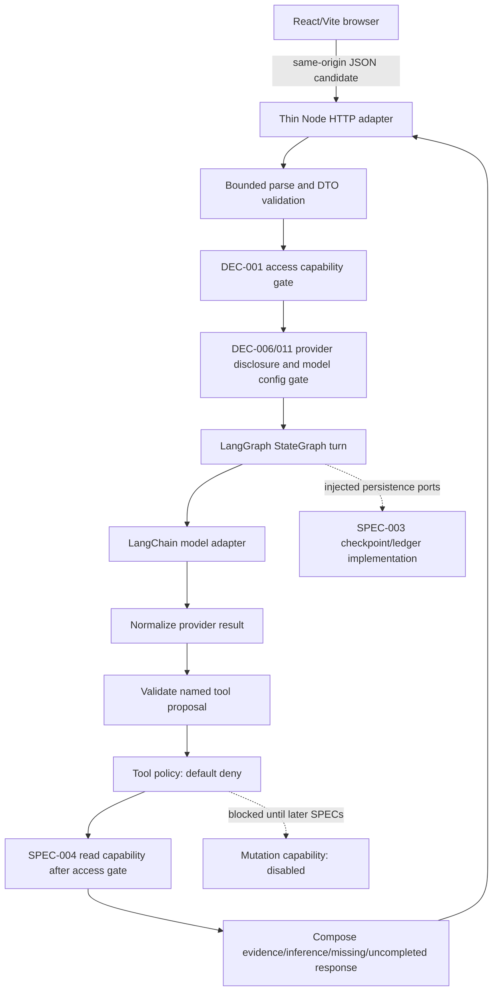

# Implementation Plan: LangGraph Runtime and DeepSeek Model Integration

**SPEC ID**: `SPEC-002` | **Version**: `1` | **Manifest hash**: assigned only if a future batch is created  
**Branch**: existing `main` preserved | **Date**: 2026-10-28 | **Spec**: [spec.md](spec.md)  
**Status**: Draft — proposed architecture for review; no implementation or activation authorization.

## Summary

SPEC-002 defines one bounded server-side agent turn using LangGraph.js, LangChain.js message/tool interfaces, and a DeepSeek adapter. The graph validates an incoming DTO, attaches server-generated correlation/version context, checks access and provider-disclosure gates, invokes a provider adapter only when approved, normalizes the response, validates any tool proposal against a server-owned registry and policy, calls the owning SPEC capability, composes a response that separates evidence from inference, and reaches one declared terminal outcome.

The proposed provider integration is LangChain's `ChatDeepSeek` adapter, behind a provider-neutral interface. The integration is documented as beta, and its package/model versions are not selected. No provider dependency is installed, no key is configured, no live call is made, and no real FlowZenit content is sent to a provider in this planning work.

The existing React/Vite application remains the browser client. A root Vercel `/api` Node Function is evaluated as a hosting option, not selected: DEC-010 remains pending. Server modules stay outside the Vite client import graph. The production registry defaults to deny; all private reads and privileged tools remain disabled until the DEC-001 access gate is approved, implemented, and verified. Durable conversation/checkpoint storage belongs to SPEC-003 and DEC-005; this SPEC defines a port and blocks capabilities that require durable replay when that port is unavailable.

## Technical Context

**Language/Version**: JavaScript ESM, existing Node.js toolchain; exact production Node runtime/version is to be verified against deployment choice.  
**Primary Dependencies**: Candidate `@langchain/langgraph`, `@langchain/core`, `@langchain/deepseek`, and `langchain`/`zod` for schema-declared tools; none are installed. Package versions and peer compatibility remain open. Existing runtime utilities are Node `fetch`, `AbortController`, and project scripts.  
**Storage**: None added by this SPEC. Checkpoint and ledger ports are defined; persistent implementation and retention belong to SPEC-003/DEC-005. No schema, migration, or Supabase runtime client is created here.  
**Testing**: Existing Node `node:test`, deterministic model/tool/checkpoint/ledger doubles, `npm test`, `npm run lint`, and `npm run build`. Live provider smoke tests remain disabled unless separately authorized, use synthetic inputs only, and do not prove access-control readiness.  
**Target Platform**: Server-side Node.js. Vercel Node Functions are one DEC-010 option. The existing Vite application remains a static/client bundle unless a separate server runtime is approved.  
**Project Type**: Existing React/Vite SPA plus proposed optional server runtime; this SPEC does not add a framework, route, or deployment configuration.  
**Performance Goals**: No latency target or financial budget is approved. Every turn must be bounded by finite configured steps, calls, payload/result limits, timeout, and retries; values/ceilings require review.  
**Constraints**: DEC-001 closes private access until adequate server-verifiable access control exists; DEC-006 blocks real FlowZenit content sent to providers; DEC-011 leaves model/API selection pending; DEC-010 leaves runtime/region/duration pending; DEC-012 leaves abuse limits pending. No new auth/session, service-role authorization, SQL tool, unbounded loop, mutation tool, external tracing, or long-term memory.  
**Scale/Scope**: One synchronous turn and one single-owner application context; no multi-user principal, organization, tenant, background worker, or long-term memory.

## Constitution Check

*GATE: assessed before design and re-checked after design.*

| Principle | Before design | After design |
| --- | --- | --- |
| Preserve product behavior | Existing Vite/React/Supabase path is the only implemented path. | Pass: add-on server path is proposed; existing browser reads and routes stay unchanged. |
| User-controlled scope | All artifacts are Draft; planning is document-only. | Pass: runtime, dependencies, provider, and Vercel deployment remain proposals; no batch/approval state changes. |
| Security and data protection | DEC-001 and DEC-006 gates remain open for protected capabilities. | Pass: deny-by-default registry, no client secrets, no private provider calls or protected reads until gates pass. |
| Tests accompany design | SPEC requires unit, integration, contract, security, deterministic evaluation. | Pass: test doubles and replay/security cases are mapped in the planned tasks; no test was executed in this document task. |
| Durable and auditable execution | Future execution uses only the approved SDD runner. | Pass: checkpoint/ledger persistence is an injected port; evidence excludes prompts, secrets, and private state. |
| Bounded correction | Existing supervisor limits remain authoritative. | Pass: no changes to attempt/time limits, pause, or recovery rules. |
| Small, reviewable changes | No server runtime exists in checkout. | Pass: proposed server-only modules and one API handler; no broad frontend or database migration. |
| Manual publication | No publication operation authorized. | Pass: no commit, push, merge, or deploy. |

**Post-design gate**: pass for planning. Production provider access, private-data access, durable resume, and mutations remain disabled behind their stated prerequisites.

## Architecture Proposal



The graph's proposed ordered nodes and routes are:

1. `validateRequest`: enforce content type, request DTO, configured body/string limits, supported fields, and request method.
2. `initializeTurn`: generate server `requestId`, `turnId`, `correlationId`, attach graph version, cancellation signal, and empty bounded ledger. A supplied `conversationId` is grouping metadata only.
3. `checkCapabilities`: resolve the server-created access decision and provider data-sharing configuration. With a closed gate, route to a bounded denied/disabled outcome before private Supabase access or provider submission containing protected content.
4. `prepareContext`: build the current-turn message list from validated input and explicitly permitted context. No history retrieval, RAG, or independent domain queries; those belong to SPEC-003/004/008/009.
5. `invokeModel`: call the injected LangChain-compatible adapter with server-owned model/tool configuration, signal, timeout, and finite invocation budget. Production adapter is disabled until DEC-006/011 and server credentials are approved/configured.
6. `normalizeModelResult`: map text/tool calls/finish reason/usage/error to the provider-neutral contract. Reject invalid or ambiguous response shapes. Provider strict mode is not a substitute for local schema checks.
7. `validateProposal`: resolve each named/versioned tool in the server registry; parse and validate arguments, enforce count/size limits, and reject unknown fields before any handler runs.
8. `authorizeAndExecute`: re-check access capability, tool policy, domain preconditions, remaining budgets, and cancellation immediately before execution. Default policy denies all protected capabilities. SPEC-004 provides read operations; SPEC-005 and SPEC-006/007 own later write authorization and mutation capabilities.
9. `composeResponse`: distinguish tool-grounded facts, model inference, missing evidence, and actions not completed. Do not present model-only assertions as database facts.
10. `finish`: set exactly one terminal outcome. Errors route through safe categories; no unbounded loop or background work is implied.

The graph may route `content-only` to response composition and `tool-call-only` to validation. A bounded tool result may return to the model for a final answer only while the configured budget remains. Invalid/denied proposals terminate or request clarification; they are not retried unchanged. A mixed non-empty content plus tool-call response is rejected by the proposed initial contract unless a provider-specific compatibility review later approves another shape.

## Module Responsibilities

| Proposed path | Responsibility | Ownership boundary |
| --- | --- | --- |
| `api/agent/turn.js` | Thin HTTP adapter for a future same-origin turn request; bounded JSON parse, invoke runtime, map response/errors. | SPEC-002 if Vercel root `api/` is selected; no domain logic. |
| `server/agent/runtime/build-graph.js` | Construct and version LangGraph `StateGraph`, explicit nodes/routes, finite recursion/step guard. | SPEC-002. |
| `server/agent/runtime/state.js` | Runtime validation and safe state shape; in-turn fields only. | SPEC-002; persistence serialization contract shared with SPEC-003. |
| `server/agent/runtime/turn.js` | Start one request, pass trusted context and abort signal, require one terminal outcome. | SPEC-002. |
| `server/agent/model/adapter.js` | Provider-neutral LangChain adapter interface and result normalization. | SPEC-002. |
| `server/agent/model/deepseek.js` | Candidate `ChatDeepSeek` setup with server-only config; no activation until decisions pass. | SPEC-002. |
| `server/agent/tools/registry.js` | Named/versioned tool schema lookup; empty/default-deny protected production registry. | SPEC-002; policy source is SPEC-005. |
| `server/agent/tools/execute.js` | Revalidate, invoke owning typed capability, sanitize bounded result; no SQL or direct domain query. | SPEC-002 adapter; SPEC-004 owns reads. |
| `server/agent/persistence/ports.js` | Checkpoint and durable idempotency interfaces only. | SPEC-002 interface; SPEC-003 persistent implementation and DEC-005 policy. |
| `server/agent/http/errors.js` | Stable public error categories/status candidate and response redaction. | SPEC-002, aligned to SPEC-001 proposed boundary. |
| `server/agent/observability/safe-events.js` | Allowlisted request/node/outcome/duration metadata; no payload logging or external trace. | SPEC-002; DEC-005/006 and SPEC-010 gate persistence/external traces. |

Paths are proposed and do not currently exist. Shared server modules must never be imported into the React/Vite entry graph. Avoid placing generic helpers in a Vercel-discovered `api/` path, where they could be treated as routes.

## Contracts and Integration

- **HTTP boundary**: Candidate `POST /api/agent/turn` same-origin JSON per [contracts/agent-turn.md](contracts/agent-turn.md). Exact path, body limits, CSRF/origin policy, streaming, HTTP statuses, and local development mechanism remain to be decided/validated. No endpoint is currently exposed.
- **Model port**: Candidate `ModelAdapter.complete({ messages, toolSchemas, modelConfig, signal, timeoutMs })`, returning normalized content, tool proposals, finish reason, optional usage, and provider error category. No raw provider response escapes the adapter.
- **DeepSeek**: Prefer evaluating `@langchain/deepseek` `ChatDeepSeek` as the LangChain provider package, currently documented as beta. Pinning versions, compatible model IDs, tool mode, response shape, strict-mode support, reasoning behavior, and fallback strategy require a compatibility spike and DEC-011. Direct DeepSeek REST via `fetch` is a fallback only if the LangChain adapter fails required contract tests; it is not selected here.
- **Tool boundary**: LangChain `tool()` declarations with structured schemas (candidate Zod) describe the model-facing names/inputs; a separate local registry and `ToolPolicy` perform runtime validation and authorization immediately before execution. Model/tool choice has no authority. Reads delegate to SPEC-004. No mutations are registered in this SPEC. No LLM-generated SQL, code, arbitrary PostgREST query, or table/column selection.
- **Supabase**: No server Supabase client may read private data before DEC-001. Existing browser publishable key and anonymous grants remain unchanged and do not grant server authorization. `service_role`/Secret must never substitute for owner authentication. When approved, this runtime delegates to SPEC-004 typed operations and a separately approved access context; it does not duplicate query logic.
- **Checkpoint/idempotency**: LangGraph checkpointer/ledger operations are ports described in [contracts/runtime-ports.md](contracts/runtime-ports.md). SPEC-003 owns durable storage and DEC-005 owns retention/deletion. Mutation execution is blocked if durable reserve/outcome acknowledgment is unavailable. In-memory saver is test-only and not crash-safe.
- **Frontend separation**: Browser sends only the proposed user-turn DTO to a same-origin route. Provider calls, graph state, server secrets, policy, private Supabase access, and tool handlers stay on the server. No browser call to DeepSeek or protected tool is allowed.

## Vercel and Vite Option Review

| Option | Fit | Integration risks | Status |
| --- | --- | --- | --- |
| Root `/api/*.js` Vercel Node Functions | Vercel documents this route style for Vite projects and supports Node runtime; it keeps server code out of the SPA bundle. | `vite dev` does not provide a matching serverless route; local dev and preview need a documented equivalent. Verify route precedence with SPA deep-link rewrites, server bundling of LangChain dependencies, cancellation and streaming config, function timeout, secret scope, and region near Supabase/provider. | Candidate to evaluate; DEC-010 pending. |
| Add a Vite server plugin such as Nitro | Co-locates API routes with Vite and can produce Vercel Functions. | Adds a framework/plugin and changes Vite build/dev behavior; increases bundle/configuration migration risk. | Alternative only; no decision. |
| Separate Node service | Clear independent backend lifecycle and local parity can be configured separately. | New service, deployment, origin/CORS, secret and monitoring surfaces; conflicts with minimal existing architecture unless DEC-010 favors it. | Alternative only; no decision. |

Vercel documents Node Functions, request cancellation, streaming, configurable duration and region; the exact account plan, region, feature configuration and limits are environment-specific and remain unverified. Function timeouts must be greater than the permitted node-level call budgets while remaining below the selected platform limit; no numerical values are committed here. A synchronous JSON response is the planning baseline from the SPEC assumption; stream protocol remains pending and must not be inferred from platform support.

## Failure, Retry, Cancellation, and Response Handling

- **Validation/authorization/domain errors**: no provider/tool retry; return `needs-clarification` or `denied` with a stable safe message.
- **Provider error**: normalize network, rate-limit/transient, timeout, configuration, unsupported format, and permanent provider failures. Retry only transient classes within a required finite count/deadline; counts, backoff, and timeout values remain pending. No fallback provider is selected.
- **Tool read error**: distinguish unavailable/error from empty query; retry only a known idempotent read and only within remaining budget. Never reframe a required query failure as no records.
- **Mutation error**: no write capability in this SPEC. Later mutations require durable idempotency reservation and recorded outcome; an ambiguous result cannot be retried unless the ledger safely resolves it.
- **Cancellation**: propagate `Request.signal`/`AbortSignal` to model and tool adapters. Stop starting nodes after cancellation. If a future mutation is in-flight, consult its durable ledger before describing completion.
- **Budget exhaustion**: stop new model/tool calls when the graph step, deadline, payload, or result budget is reached and emit a terminal outcome with an explicit uncompleted-action list.
- **Error envelope**: use candidate codes from SPEC-001 boundary; status mapping and public wording remain unapproved. No stack, SQL, token, provider body, private row, or raw exception is returned.

## Secrets, Logging, and Traceability

- Keep `DEEPSEEK_API_KEY` or the eventual server provider secret in runtime-only environment configuration. Never prefix secrets with `VITE_`; never place secrets in source, test fixtures, client assets/maps, graph state persisted to browser, or logs.
- No Supabase Secret/service_role credential is introduced by SPEC-002. If a future approved server client requires a privileged key, it still cannot act as owner authorization and remains unusable for private access until DEC-001 is satisfied.
- Safe operational events may include server correlation ID, graph version, node/tool name and version, outcome class, duration, call counts, and dependency category. Exclude prompts, transcripts, task names, arguments, results, reasoning fields, cookies, authorization headers, raw provider/database errors, and environment objects.
- In-process request metadata is not a retention decision. Persistent audit, checkpoint storage, and LangSmith traces remain disabled until DEC-005/006 and SPEC-010 are resolved.

## Proposed Limits and Decisions Still Open

The implementation must have finite configuration for maximum graph steps/model calls/tool calls, body and message size, model response and tool-result size, provider/tool timeouts, retry count/backoff, and deadline. Missing production bounds disable execution. The following is a **technical starting proposal for user review, not an approved policy or financial budget**. Runtime/package/provider tests and DEC-012 may justify changes before implementation.

| Bound | Proposed default | Proposed hard ceiling | Notes |
| --- | ---: | ---: | --- |
| Graph node steps per turn | 20 | 24 | Includes all model/tool loops; stop when reached. |
| Model invocations per turn | 2 | 3 | Tool-result follow-up consumes another invocation. |
| Tool proposals executed per turn | 3 | 4 | Count every tool call; unknown/denied proposals still consume a step. |
| Provider timeout per attempt | 15 s | 20 s | Remaining global deadline takes precedence. |
| Read-tool timeout per attempt | 5 s | 10 s | Writes are not enabled by this SPEC. |
| Automatic retries | 1 | 1 | Transient provider errors or known idempotent reads only; no retry for invalid/denied results. |
| Retry delay | 250 ms initial, exponential | 1 s per wait | Honor provider `Retry-After` only when it fits the remaining deadline; tests inject a deterministic clock/jitter source. |
| Total turn deadline | 90 s | 120 s | Hard stop across all nodes, retries, and I/O; hosting max duration must exceed the selected deadline. |
| HTTP body | 16 KiB | 32 KiB | Exact HTTP contract requires review. |
| User message | 4,000 code points | 8,000 code points | In addition to body byte limit. |
| Single tool result | 16 KiB | 32 KiB | Explicitly mark truncation; never silently drop evidence. |

These values are conservative starting points for discussion only. They are not copied to runtime config or Vercel settings until reviewed. The global deadline bounds compounded retries; Vercel account plan, function max duration, provider latency, data location and DEC-012 abuse controls must be checked together. No currency/token-spend ceiling is inferred.

| Decision / dependency | What remains open | What stays disabled until resolved |
| --- | --- | --- |
| DEC-001 | Future server-verifiable access control; no mechanism selected. | Private reads and privileged tools/endpoints. |
| DEC-005 / SPEC-003 | Retention/deletion and durable graph checkpoint/ledger storage. | Persistent history, cross-request resume, durable mutation idempotency. |
| DEC-006 | Provider-eligible fields, redaction, opt-out, retention/location. | Any real FlowZenit content sent to DeepSeek or external tracing. |
| DEC-010 | Host/runtime, region, plan, max duration, background/queue need. | Deployment/runtime-specific route and production execution configuration. |
| DEC-011 | Exact DeepSeek model ID/version, API mode, response format, reasoning/tool mode, adapter version/fallback. | Live provider adapter. |
| DEC-012 | Abuse/usage bounds and numeric limits; no cost budget. | Production turn/tool quotas and final timeout/retry/step ceilings. |
| Separate user decision | Buffered response versus streaming; request size; retry/backoff defaults. | Public HTTP/stream contract. |
| SPEC-005 / DEC-009 | Tool authorization policy and confirmation rules. | Any mutation tool; protected tool policy beyond default deny. |

## Safe Capability Matrix

| State | Safe behavior |
| --- | --- |
| Planning and tests now | DTO/state validators, graph topology, error mapping, result composition, and replay/security tests may use synthetic inputs, deterministic model doubles, injected test tools, and in-memory test adapters. No provider call, private database call, or code execution occurs in this documentation task. |
| Production while gates are closed | The proposed runtime and endpoint remain disabled. Existing FlowZenit app behavior continues unchanged. No live provider call, protected read, mutation, or persisted conversation is available. |
| Future non-private provider use | Requires DEC-006/011, version-compatibility evidence, secret configuration, numeric bounded policy and runtime approval; only fields explicitly allowed by the approved disclosure policy may be sent. |
| Future private read | Requires DEC-001 plus the owning SPEC-004 contract and approved access capability. |
| Future write/action | Requires DEC-001, DEC-009, SPEC-005 and the owning SPEC-006/007 tool, plus durable checkpoint/idempotency storage and approved retention. |

## Dependencies and Contracts

- **Prerequisite SPECs**: SPEC-001@1 for server boundary/security; SPEC-004@1 for typed transactional reads. Both remain Draft and must be included in the exact future implementation sequence.
- **Downstream**: SPEC-005 consumes the runtime/tool proposal interface and defines guardrails; SPEC-003 supplies durable memory/checkpoint behavior separately. SPEC-006/007 may later provide writes. None is treated as already implemented.
- **API/data contracts**: [contracts/agent-turn.md](contracts/agent-turn.md) and [contracts/runtime-ports.md](contracts/runtime-ports.md) are proposed internal contracts only.
- **Database changes**: None. No Supabase schema, migration, grant, RLS policy, connection factory, or data are changed.
- **Out-of-scope files/systems**: Existing `src/` app, `src/lib/supabase.js`, `vite.config.js`, deployment settings, database/migrations, provider account/configuration, chat UI, memory policy, RAG, writes, external tracing, batch/runner, and source control publication.

## Execution and Recovery Plan

- **Sequential phases**: (1) ports/schemas and test doubles, (2) bounded graph lifecycle and terminal routing, (3) model adapter and response normalization, (4) typed proposal validation/deny-by-default tool path, (5) checkpoint/ledger integration contract and failure/security gates, (6) hosting integration only after DEC-010. Protected capabilities stay disabled until prerequisites pass.
- **Parallel tasks**: Unit tests for state, adapter normalization, and error mapping may be separate after interfaces stabilize and only when file scopes are disjoint. Graph integration, provider compatibility, and policy wiring are sequential.
- **Agent assignments**: None in this implementation plan; future SDD parallelism must be task-authorized and use disjoint paths.
- **Failure fingerprints**: `graphVersion/node/terminalCategory`, normalized provider category/status family, tool name/version/schema failure, checkpoint/ledger operation, and synthetic fixture ID; never hash or log private prompts/arguments.
- **Checkpoint/recovery data**: graph version, turn/correlation IDs, node cursor, canonical proposal hash, durable idempotency key and safe outcome reference. Exclude secrets, raw prompts in audit/logs, provider bodies, reasoning, auth material, and raw tool data. Long-term retention remains DEC-005/SPEC-003.

## Quality Gates

| Gate | Required | Command/method | Acceptance evidence |
| --- | --- | --- | --- |
| Lint/static checks | Yes | `npm run lint` | No client import of `server/`/`api/`; no secret-bearing `VITE_*` or debug logging. |
| Build/type check | Yes | `npm run build` and `npm test` | ESM/module compatibility verified; graph/runtime code remains server-side. |
| Unit/integration | Yes | `node --test` / `npm test` with deterministic doubles | Every terminal route, bounded retries, cancellation, malformed/ambiguous response, and provider/tool errors. |
| Database/API contracts | Yes | HTTP/model/tool/checkpoint port contract tests; isolated synthetic target only if a future contract requires it | Closed access gate makes zero private Supabase/provider calls; typed SPEC-004 delegation only. |
| Replay/idempotency | Yes | Fake durable checkpoint/ledger contract suite; later isolated integration for SPEC-003 | Completed synthetic action is not re-executed; no mutation executes without durable reserve/outcome acknowledgment. |
| Security/evaluation | Yes | `tests/security/` and versioned synthetic fixtures | Unauthorized/unknown tools execute zero times; provider/private values and prompts are absent from client bundle/logs; deterministic graph path. |
| Live provider smoke | Conditional and separately opt-in | Synthetic prompt, server secret, only after DEC-006/011 and explicit enablement | Actual model/API/tool-call shape recorded without exposing key/content; otherwise `NOT VERIFIED`. No call is made during this planning task. |

## Entry and Completion Criteria

**Entry for implementation**: SPEC-002 exact version is in a user-authorized SDD batch and admitted by the supervisor; prerequisites SPEC-001 and SPEC-004 pass required gates; proposed runtime/dependency/model/API choices and numerical bounds have review; no real provider call occurs before DEC-006/011; no protected endpoint/tool is enabled before DEC-001; any persistent resume/mutation execution requires SPEC-003/DEC-005 adapter; DEC-010 resolves hosting settings before deployment integration.

**Completion**: Deterministic graph tests cover all declared states/routes/failures and finite budgets; provider results normalize without raw data leakage; no arbitrary tool path exists; errors and logs are allowlisted; replay tests prove no duplicate synthetic mutation; open gates leave protected capabilities disabled; actual implementation checks report PASS/FAIL/NOT VERIFIED with evidence. Completing this SPEC does not approve a provider, runtime, public endpoint, persistence policy, mutation, or private-data access.

## Project Structure

### Documentation (this feature)

```text
specs/SPEC-002/
├── spec.md
├── plan.md
├── research.md
├── data-model.md
├── quickstart.md
├── contracts/
│   ├── agent-turn.md
│   └── runtime-ports.md
├── checklists/requirements.md
└── tasks.md
```

### Proposed source paths (not created)

```text
api/agent/turn.js
server/agent/http/{request.js,response.js,errors.js}
server/agent/runtime/{build-graph.js,state.js,turn.js,limits.js}
server/agent/model/{adapter.js,deepseek.js,normalize.js}
server/agent/tools/{registry.js,validate.js,execute.js}
server/agent/persistence/ports.js
server/agent/observability/safe-events.js
tests/fixtures/agent/{turns.js,models.js,tools.js,persistence.js}
tests/unit/agent/{state,graph,model-adapter,errors}.test.js
tests/contracts/agent/{http,tool,checkpoint,replay}.test.js
tests/security/agent/{access-gate,disclosure,secret-boundary,logging}.test.js
```

**Structure decision**: A root API handler and `server/agent/` modules are a candidate only if DEC-010 selects Vercel Node Functions. They stay outside `src/` and the Vite client graph. A different DEC-010 choice may change these paths without changing domain ownership.

## Official References

- LangGraph workflow and checkpoint model: [Thinking in LangGraph](https://docs.langchain.com/oss/javascript/langgraph/thinking-in-langgraph), [Persistence](https://docs.langchain.com/oss/javascript/langgraph/persistence).
- LangChain JavaScript `ChatDeepSeek` adapter and current beta/support matrix: [ChatDeepSeek integration](https://docs.langchain.com/oss/javascript/integrations/chat/deepseek), [API reference](https://reference.langchain.com/javascript/langchain-deepseek/ChatDeepSeek).
- DeepSeek tool call argument validation, beta strict mode, streaming fields, and tool protocol: [Tool Calls](https://api-docs.deepseek.com/guides/tool_calls/), [Thinking Mode](https://api-docs.deepseek.com/guides/thinking_mode/), [Chat Completions API](https://api-docs.deepseek.com/api/create-chat-completion/).
- Vercel Vite root `api/` functions and runtime notes: [Vite on Vercel](https://vercel.com/docs/frameworks/frontend/vite), [Node.js Functions](https://vercel.com/docs/functions/runtimes/node-js), [Function cancellation API](https://vercel.com/docs/functions/functions-api-reference), [duration](https://vercel.com/docs/functions/configuring-functions/duration), [streaming](https://vercel.com/docs/functions/streaming-functions).
