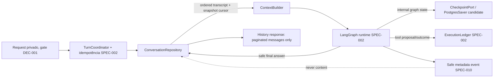

# Plano técnico: histórico, memória e checkpoints

**SPEC ID**: `SPEC-003` | **Versão**: `1` | **Manifest hash**: atribuído somente ao criar lote  
**Branch**: `main` preservada | **Data**: 2026-10-28 | **Spec**: [spec.md](spec.md)  
**Status**: Draft — arquitetura proposta; não autoriza implementação.

## Resumo

SPEC-003 propõe persistir o histórico visível do proprietário único separado do estado interno do LangGraph. O histórico canônico é uma sequência ordenada de mensagens de uma conversa; o checkpointer guarda snapshots internos necessários a uma execução/interrupção; a compactação é um resumo derivado, versionado e limitado à mesma conversa; store de memória semântica entre conversas fica desligado; dados transacionais continuam nas entidades existentes; auditoria continua sob SPEC-010, com metadados mínimos.

O candidato para checkpoints é `@langchain/langgraph-checkpoint-postgres`, que usa PostgreSQL e aceita schema configurável; ainda depende de validação de compatibilidade com o runtime e Supabase/DEC-010. A API oficial separa checkpointer por thread de store cross-thread, então a proposta não configura LangGraph Store. Não criar tabelas, executar `setup()`, instalar pacote ou persistir conversa nesta fase. DEC-005 bloqueia produção até a política de retenção/deleção/exportação/compartilhamento ser aprovada; DEC-001 bloqueia qualquer endpoint privado até um controle de acesso separado ser aprovado, implementado e verificado.

## Contexto técnico

**Linguagem/runtime**: JavaScript ESM; Node/runtime não está pinado e depende de DEC-010.  
**Dependências existentes**: o `package.json` não inclui `@langchain/langgraph` nem checkpointer; o pacote Postgres é candidato pesquisado, não instalado nem aprovado.  
**Storage atual**: Supabase PostgreSQL usado pelo frontend para demandas/rotinas e schema operacional `sdd`; não há storage de conversas. O schema `sdd` e `sdd.checkpoints` pertencem exclusivamente ao runner e não podem ser reutilizados.  
**Storage candidato**: schema privado e isolado para tabelas de histórico mais schema configurado do checkpointer LangGraph. Nomes, grants, migration strategy e conexão seguem pendentes; nenhuma tabela é aprovada aqui.  
**Testes existentes**: `npm test` chama `node --test`; não há teste de chat, histórico ou checkpointer. Nenhum teste foi executado no planejamento.  
**Limites**: nenhuma persistência real, consulta privada, endpoint ou envio de transcrição a um provedor enquanto DEC-001, DEC-005/006 e gates do runtime não estiverem satisfeitos.

## Constitution Check

| Princípio | Avaliação |
|---|---|
| I. Preservar comportamento | As tabelas de domínio e o cliente React/Vite não mudam. Histórico é storage aditivo, nunca reaproveita `demandas`, `recorrente` ou `sdd`. |
| II. Escopo do usuário | Nenhum usuário/tenant novo, método de autenticação, retenção, exportação ou batch é aprovado. Planos e storage ficam Draft. |
| III. Segurança | Sem conteúdo em frontend, logs, trace ou audit genérico. Queries privadas permanecem fail-closed; controle de acesso não é escolhido aqui. |
| IV. Testes | Fixtures sintéticas cobrem paginação, replay, concorrência, corrupção, expiração e apagamento; gates não executados ficam `NOT VERIFIED`. |
| V. Durabilidade | Checkpoint e ledger têm protocolos distintos; retomar ferramenta exige resultado durável consultável. Nenhuma memória de execução do SDD é reutilizada. |
| VI. Limites | 5 tentativas/120 minutos do runner continuam inalterados; limites de contexto/chamadas seguem DEC-011/012 e SPEC-002, sem números inventados. |
| VII. Mudança mínima | Checkpointer existente da biblioteca é avaliado antes de custom saver; nenhuma dependência ou migration é criada agora. |
| VIII. Publicação manual | Não há commit, push, merge, deploy ou alteração de dados. |

## Modelo de confiança e responsabilidades

| Artefato | Fonte/owner | Uso e visibilidade | Tratamento proposto |
|---|---|---|---|
| Histórico canônico | SPEC-003 | Conversas paginadas que a UI pode exibir após gate. | Mensagens user/assistant finais e resumo seguro de tool; ordem imutável. |
| Checkpoint LangGraph | SPEC-002 port; persistência SPEC-003 | Execução interna por thread/superstep, nunca histórico da UI. | Versionado, schema-validado, não exportado como mensagem; pode conter cópia limitada do contexto de execução. |
| Context summary | Derivado da conversa, sem store cross-thread | Auxilia contexto de uma conversa quando a história excede orçamento. | Versionado com `throughMessageSeq`; nunca altera/apaga transcript e não é verdade transacional. |
| Memória semântica longa | Fora do escopo | Preferências/fatos entre threads. | Não criar LangGraph Store, embedding ou retrieval de transcript nesta SPEC. |
| Dados de domínio | SPEC-004/006/007 | Fonte de verdade para demands, status, datas e rotinas. | Reconsultar ferramenta tipada; não inferir estado atual de resumo/checkpoint. |
| Ledger de execução | SPEC-002 | Idempotência e outcome de tool/turn. | Verificar antes de retomar side effect; não duplicar implementação em SPEC-003. |
| Audit/observability | SPEC-010 | Metadados operacionais minimizados. | Sem conteúdo de conversa ou checkpoint; retenção/fields seguem DEC-005/006. |

Histórico e checkpoint têm finalidade e acesso distintos, embora um snapshot do graph possa conter cópia de mensagens recentes necessárias para retomar o turno. Essa duplicação potencial recebe classificação e ciclo de vida próprios; checkpoint não é a fonte canônica do transcript e nunca é serializado à resposta de histórico.

## Arquitetura proposta



`DEC-001` gate precede qualquer leitura do histórico ou checkpoint. Mesmo um `conversationId` correto, aleatório ou difícil de adivinhar só localiza dados; não autentica nem autoriza. Sem gate, responder `ACCESS_DISABLED` antes de chamar repository/checkpointer.

### Módulos futuros e ownership

| Caminho proposto | Responsabilidade | Dono |
|---|---|---|
| `server/agent/memory/conversation-contracts.js` | DTOs de conversa/mensagem/cursor e envelopes de erro. | SPEC-003; endpoint é SPEC-001/002. |
| `server/agent/memory/conversation-repository.js` | Append idempotente, paginação por snapshot/sequence, estado de lifecycle e read-back. | SPEC-003; transação/adaptador depende DEC-010. |
| `server/agent/memory/context-builder.js` | Context window baseado em transcript, orçamento e summary versionado; não acessa banco sem gate. | SPEC-003; runtime/provider budget integra SPEC-002. |
| `server/agent/memory/checkpoint-envelope.js` | Validar thread, graph/state version, turno, serializer envelope, integridade/expiry e ledger preconditions. | SPEC-003 sobre `CheckpointPort` SPEC-002. |
| `server/agent/memory/lifecycle.js` | Guardar deletion/expiry workflow sob política aprovada; bloquear leituras e turns durante exclusão. | SPEC-003/DEC-005. |
| `server/agent/persistence/ports.js` | Interface existente de checkpoint/ledger. | SPEC-002; adaptar por contrato, não reimplementar. |
| `server/agent/observability/safe-events.js` | IDs e categorias não sensíveis, sem conteúdo. | SPEC-002/SPEC-010. |
| `tests/fixtures/conversation/` | Mensagens, checkpoint envelopes, ledger outcomes, races e corruption sintéticos. | Testes. |

Todos os caminhos são propostas e não existem no checkout. A chamada HTTP permanece desabilitada e sob SPEC-001/002. O frontend React/Vite não recebe uma chave de Supabase, token de ferramenta, checkpoint nem acesso direto ao novo storage.

## Persistência e checkpoint

- Histórico candidato em tabelas aditivas de schema privado dedicado, separado do schema operacional `sdd`. A proposta lógica é `conversations` e `messages`; nenhuma DDL/role/RLS/grant é selecionada.
- `conversation_id` opaco UUID pode também ser o `thread_id` LangGraph (mesmo identificador, 1:1) para simplificar associação; tem tamanho compatível com o limite documentado pelo checkpointer, mas nunca é `owner_id` ou prova de autorização. Confirmar se manter IDs separados melhora o adaptador na spike.
- `message_seq` monotônico por conversa e chave única `(conversation_id,message_seq)` ordenam transcript. Atribuição é transacional; cursor inclui `snapshotMaxSeq` e `lastMessageSeq`, limitando páginas ao snapshot capturado e evitando repetição quando chegam mensagens novas.
- `PostgresSaver` é candidato para checkpointer; a documentação LangGraph.js mostra suporte a schema explícito e `setup()` para as tabelas internas. Nenhum código executará `setup()` na inicialização da Function; versão, DDL, schema, grants e upgrade devem ser revisados/aplicados como operação SDD aprovada e isolada. O adapter usa a porta SPEC-002.
- Envelopes guardam `thread_id`, `checkpoint_ns`, `checkpoint_id`, `parentCheckpointId`, `graphVersion`, `stateSchemaVersion`, `turnId`, `serializerVersion`, referência/estado do ledger e, se aprovado, `expiresAt`. Versões/turno podem ficar no metadata do checkpoint sem alterar a assinatura compartilhada da porta; confirmar compatibilidade no teste de contrato.
- Antes de retomar: gate de acesso; ID e namespace conferidos; checkpoint presente, válido, íntegro e dentro do prazo da política; graph/state/serializer compatíveis; estado dos tools resolvido no ledger. Qualquer falha termina em `NOT_FOUND`, `EXPIRED`, `CORRUPT`, `INCOMPATIBLE` ou `LEDGER_UNRESOLVED`, sem executar tool pendente.
- Hash/digest do payload é candidato para detectar corrupção acidental, não autenticidade nem autorização. Serializer e version validator continuam necessários. Assinatura/criptografia adicional permanece alternativa a pesquisar/aprovar, sem prometer segurança pela hash.
- Expiração, pruning e tombstone são calculados somente a partir da DEC-005 aprovada. Enquanto pendente, não há TTL, purge schedule ou persistência de produção.

## Histórico, idempotência e concorrência

Cada request recebe `requestId` e `turnId` do servidor. `conversationId` pode ser fornecido como um localizador opaco; ids inválidos/ausentes recebem outcome estável. User message, final assistant message e terminal turn outcome se associam ao mesmo `turnId` e à reserva idempotente do ledger, para retry retornar a resposta já gravada sem duplicar mensagens nem invocar de novo ferramenta concluída.

Uma única execução mutável por conversa é a política técnica recomendada para revisão: usar uma reserva/lease compare-and-set em armazenamento durável; segunda requisição em andamento recebe `TURN_IN_PROGRESS` ou fica serializada conforme DEC-010/configuração aprovada. Não aceitar atualizações concorrentes de contexto. A decisão final queue-versus-conflict fica pendente de teste/runtime, mas nenhum caminho pode duplicar `message_seq` ou executar side effects concorrentes sem ledger.

On active turn: interruption conserva status resumível apenas com checkpoint e ledger conclusivos; timeout/cancelamento sem status durável não vira `completed`. No resume, a execução usa exatamente o mesmo `thread_id`/turn context e graph version. Já concluído no ledger significa devolver outcome; `started`/`uncertain` sem resultado conhecido bloqueia replay; `not started` só pode retomar se o checkpointer comprovar ponto seguro e nenhuma tool pendente.

Para delete race, proposta: transação marca lifecycle `deleting`, bloqueia novos reads/appends; sinaliza cancelamento da execução; aguarda terminal/outcome ou deixa ledger recuperar resultado; então apaga transcript, summaries e checkpoints no escopo aprovado. Uma tombstone não contém conteúdo e só existe se DEC-005 permitir. Sem DEC-005, esse fluxo é apenas contrato para fixtures, não serviço habilitado.

## Contexto e compactação

`ContextBuilder` calcula envelope de entrada dentro do limite efetivo de SPEC-002/model/provider. Nenhum valor numérico é escolhido aqui; limite real depende DEC-011/012 e teste de payload. Reserva espaço a instruções, resposta e tools conforme configuração futura. Mantém mensagens recentes inteiras até caber, sem truncar payload no meio de mensagem. Para contexto antigo, estratégia proposta em duas fases: primeiro janela recente com indicação explícita de omissão; depois resumo por conversa versionado quando DEC-006 autorizar enviar o conteúdo a um provedor.

Resumo registra `[fromMessageSeq, throughMessageSeq]`, versão do formato/gerador, `sourceTranscriptVersion` e timestamp; regeneração nunca altera transcript. Conteúdo resumido é derived conversation data com mesma política de acesso/lifecycle, nunca memória cross-thread. Resumo pode informar contexto geral mas não deve responder status, data, hora ou vínculo transacional exato; consultas chamam SPEC-004. Quando summary estiver ausente/stale, reconstruir a partir do transcript conforme budget ou pedir esclarecimento; não inventar memória.

Durante planejamento/testes, sumarização usa doubles determinísticos e dados sintéticos. Nenhum texto real de conversa é enviado a DeepSeek, Gemini ou LangSmith antes de DEC-006; persistência real continua bloqueada por DEC-005 e DEC-001.

## Dependências e decisões

| Pendência | Impacto e limite |
|---|---|
| DEC-001 | Bloqueia todo histórico/checkpoint privado e endpoint até controle de acesso adequado separado ser aprovado, implementado e verificado. Não escolher Auth, owner ID, session ou grant. |
| DEC-005 | Retenção, exclusão, exportação e compartilhamento; bloqueia produção de histórico/checkpoint/summary e definição de TTL, purge e tombstone. |
| DEC-006 | Disclosure, campos, redaction, retention/localização do provedor; bloqueia summarization/compaction com conversas reais e LangSmith. |
| DEC-010 | Runtime, pool, schema, region, background/worker; bloqueia escolha da conexão/checkpointer e lifecycle purge. |
| DEC-011 / DEC-012 / SPEC-002 | Modelo/context window e uso; bloqueia limite numérico e contrato final de compaction budget. |
| SPEC-002 | CheckpointPort, ExecutionLedger, graph/state metadata e terminal outcomes; integration contract must preserve completed tool outcomes. |
| SPEC-010 | Auditoria persistente/trace; SPEC-003 não cria evento store concorrente. |

DEC-002/003 permanecem aprovadas; este escopo não cria entidades de domínio e datas do histórico são timestamps do sistema, sem alterar America/Cuiaba scheduling values.

## Quality gates futuros

| Gate | Evidência |
|---|---|
| Unitário | DTOs, cursor/snapshot pagination, state classification, context-budget planner, summary provenance, expiry/version validators. |
| Contrato LangGraph | CheckpointPort round trip, namespace, graph/state/serializer versions, corrupt payload, migration compatibility, pending writes and resume semantics. |
| Integração isolada | Append/retrieval, monotonic ordering, duplicate turn, concurrent turn serialization, checkpoint+ledger outcomes, delete race and retention fixture. |
| Segurança | DEC-001 closed = zero repository/checkpointer calls; thread IDs/cursors not auth; no transcript in client bundle/logs/audit; no synthetic tenant/owner support. |
| Privacidade | synthetic secret sentinels prove hidden tool state/provider payload not returned or logged; delete removes all retrievable derived rows under a test policy. |
| Geral | `npm test`, `npm run lint`, `npm run build`, record actual exits. No test was run in planning. |

## Entrada e conclusão

**Entrada de implementação**: SPEC-003@1 admitted through an explicitly approved batch; SPEC-001/002 compatible; DEC-001 control separately approved/implemented/verified; DEC-005 retention/deletion/export/sharing approved; DEC-006 provider treatment approved before any transcript summary is sent externally; DEC-010 store/runtime adapter reviewed; required DEC-011/012 context bounds configured. Without those, implement/test only synthetic adapters and keep production persistence disabled.

**Conclusão**: history paging deterministic; duplicate/replay safe; resume never executes pending operation without ledger proof; corrupt/expired/version-incompatible checkpoint stops; conversation categories remain separate; context stays within configured budget without rewriting history; deletion scope is verified under an approved test policy; production endpoints remain gated until security/lifecycle decisions are met.

## Estrutura documental e caminhos de fonte futuros

Documentos: `specs/SPEC-003/{spec.md,plan.md,research.md,data-model.md,quickstart.md,tasks.md}`, `contracts/{conversation-history.md,checkpoint-resume.md,context-compaction.md,lifecycle-deletion.md}`, e `checklists/requirements.md`.

```text
server/agent/memory/{conversation-contracts,conversation-repository,context-builder,checkpoint-envelope,lifecycle}.js
server/agent/persistence/ports.js  (SPEC-002 owner; compatible interface only)
tests/fixtures/conversation/{messages,checkpoints,ledger,races}.js
tests/unit/conversation/{cursor,context,checkpoint-envelope}.test.js
tests/contracts/conversation/{history,checkpoint,ledger,lifecycle}.test.js
tests/integration/conversation/{pagination,resume,concurrency,deletion,access-gate}.test.js
supabase/migrations/  (only after DEC decisions and exact approved SPEC/batch authorize schema work)
```

Nenhum caminho de código, package, database schema ou endpoint é criado nesta fase.
