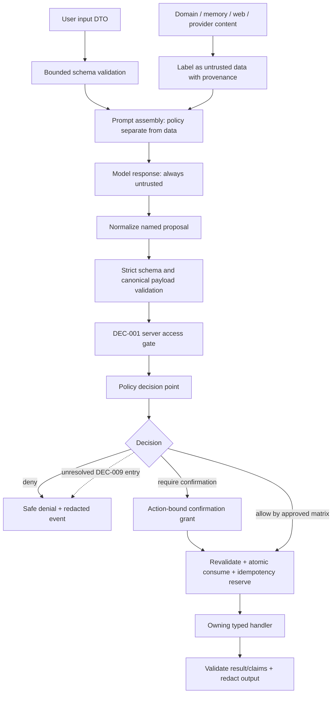

# Implementation Plan: Agent Guardrails and Action Authorization

**SPEC ID**: `SPEC-005` | **Version**: `1` | **Manifest hash**: assigned only if a future batch is created  
**Branch**: existing `main` preserved | **Date**: 2026-10-28 | **Spec**: [spec.md](spec.md)  
**Status**: Draft — proposed security architecture for review; no implementation authorization.

## Summary

SPEC-005 places a deterministic server policy decision point at the action executor, immediately before each side effect. It treats user text, model output, domain records, memory, provider responses, and web content as untrusted data. Every proposed action is schema-validated, canonicalized, checked against a server-created capability, current target/domain preconditions, and the approved confirmation matrix before a handler may run. Responses, errors, and security events use allowlisted/redacted fields.

Prompt-injection detectors and prompt formatting are defense in depth only. They cannot grant a capability, approve an action, or establish identity. DEC-001 remains an independent prerequisite for every private-data read and privileged effect. DEC-009's per-action confirmation matrix remains pending; this plan does not classify real actions or decide which requires confirmation. Until a matrix entry is approved, protected action policy denies the operation. A synthetic matrix may be used only in tests.

The one-time, expiring, action-bound grant described in `spec.md` remains a technical proposal. This plan refines its possible interface and replay safeguards without selecting a store, TTL, client flow, or action matrix. Writes remain owned by SPEC-006/007, graph/ledger ports by SPEC-002, and read tools by SPEC-004.

## Technical Context

**Language/Version**: JavaScript ESM and existing Node tooling; no server runtime exists in the checkout.  
**Primary Dependencies**: Existing `node:test`, Node crypto primitives, and project code. Runtime schema library remains aligned with the package decision in SPEC-002; none is installed here. Any Zod/LangChain schema declaration is not a replacement for server policy authorization.  
**Storage**: No schema or migration selected. The confirmation grant requires an atomic one-time consume interface if later enabled; backend and retention remain open. Action idempotency integrates with SPEC-002's ledger port and owner operation.  
**Testing**: `node --test`, `npm test`, `npm run lint`, `npm run build`; versioned synthetic adversarial fixtures, fake policy matrix, fake confirmation store, and fake action ledger. Isolated database tests only if a future approved store/handler contract requires them.  
**Target Platform**: Server-side policy/executor boundary selected by SPEC-002/DEC-010. No browser policy implementation is authoritative.  
**Project Type**: Security module around a future single-owner agent runtime; no client UI or product domain behavior changes.  
**Performance Goals**: No latency/security-detector accuracy threshold or numerical abuse budget is approved. Checks must use SPEC-002's configured bounded request/tool limits; DEC-012 remains pending.  
**Constraints**: No action/confirmation matrix invention; no new owner/user/tenant/authentication mechanism; no RLS/grant changes; no direct model-to-Supabase path; no SQL, executable code, or arbitrary query fragments in structured tool/control arguments; preserve free-form text as inert untrusted data; no mutation before DEC-001, relevant DEC-009 entry, and durable idempotency conditions.  
**Scale/Scope**: Single user context, one action proposal at a time at the policy boundary; the policy code must not introduce multi-user or organization semantics.

## Constitution Check

*GATE: assessed before design and re-checked after design.*

| Principle | Before design | After design |
| --- | --- | --- |
| Preserve product behavior | Current UI performs direct Supabase operations with client-side confirms; those flows are out of scope. | Pass: no UI, database permission, or business-rule change is proposed. |
| User-controlled scope | SPEC-005 remains Draft; DEC-009 is pending. | Pass: no batch, confirmation matrix, action policy, or implementation is approved by this plan. |
| Security and data protection | No agent policy/executor exists; DEC-001 access gate is closed. | Pass: policy denies by default, prompt/data do not authorize, output/events are redacted, and access gate remains separate. |
| Tests accompany design | The SPEC requires adversarial, confirmation, redaction, and replay cases. | Pass: synthetic fixtures and zero-side-effect tests are mapped to tasks; no test was run in this document task. |
| Durable and auditable execution | SDD runner is the future execution source of truth. | Pass: safe event schema has no prompts/payloads; persistence and retention are unselected. |
| Bounded correction | Existing limits and pause rules remain authoritative. | Pass: no governance limits are changed; runtime budgets come from SPEC-002/DEC-012. |
| Small, reviewable changes | There is no guardrail module today. | Pass: proposed server policy, validators, confirmation port, and redaction tests only; no schema/UI change. |
| Manual publication | No publication authorized. | Pass: no commit, push, merge, or deploy. |

**Post-design gate**: pass for planning. Production private access and every privileged action remain blocked by DEC-001; actions whose confirmation policy depends on DEC-009 remain disabled.

## Security Boundary and Data Flow



Trust labels and prompt delimiters help preserve provenance, but model input still contains natural language. Therefore they are not a security boundary. The server ignores claims in user/model/retrieved content about permission, approval, target scope, or completed side effects.

## Policy and Authorization Design

### Separate checks

1. **Access control (DEC-001)**: Is there a separately approved server access capability for this request? No mechanism is chosen here. A confirmation or policy result cannot satisfy it.
2. **Capability policy**: Is the exact named/versioned operation enabled and within the server-created capability/domain scope?
3. **Input and precondition validation**: Does the DTO satisfy the owning schema, canonical target, field allowlist, and current domain constraints? The owning SPEC remains the authority for its business rule.
4. **Confirmation policy (DEC-009)**: Does an approved matrix entry allow the operation directly, require confirmation, or deny it? A missing entry is a denial.
5. **Execution/idempotency**: Is the exact action confirmed if needed, and can the owning handler reserve and record an idempotent outcome before a side effect?

The proposed PDP returns `ALLOW`, `DENY`, or `REQUIRE_CONFIRMATION` plus a stable safe reason category, policy version, and correlation ID. It runs again immediately before the handler. No model classifier or prompt result can produce `ALLOW`.

### DEC-009 behavior

The actual operation-by-operation matrix, risk thresholds, and validity details are **not specified here**. No real action is assigned a low/high risk class or a confirmation rule. A policy configuration without a resolved entry denies that operation. User Story 2's “lower-risk action without unnecessary confirmation” is implementable only after DEC-009 supplies the matrix. Until then, no mutation/privileged action is enabled. Tests may use a versioned synthetic matrix solely to validate the generic policy branches.

## Input and Untrusted-Content Handling

- Reuse the bounded JSON/body and runtime limit mechanism from SPEC-002; no new numeric limit is set. Reject unknown fields, invalid operation/version, excessive nesting, invalid IDs/enums/date/time formats, and schema-invalid arguments before any handler.
- User text, returned database fields, memories, provider content, external web results, and previous model output are represented as data segments with source kind and optional provenance reference. Their contents never enter privileged instruction templates as code or policy.
- Construct prompts with server-authored policy instructions in dedicated messages and untrusted segments separately identified and escaped/serialized as content. This improves separation but does not prevent all injection.
- Normalize only typed fields to their contract forms (e.g., decimal IDs and canonical dates). Preserve free text rather than silently rewriting names. Confusable/control-character checks may produce a suspicious signal; they do not silently map one record name or grant permission.
- Treat model tool calls as untrusted JSON: parse under byte/depth bounds, enforce exact object schema and enum formats, reject extra fields, and resolve only a server allowlisted tool/version. Reject SQL, executable code, arbitrary PostgREST operators, and table/column selection in structured tool/control arguments. Preserve free-form user/domain text as inert untrusted content; never execute or reinterpret it as a query.
- Injection detection is only defense in depth. A positive detector may signal the request for safe denial/clarification under the policy; a negative result never permits an action. The detector never upgrades an event to confirmed attack.

## Confirmation and Idempotency Proposal

See [contracts/confirmation-lifecycle.md](contracts/confirmation-lifecycle.md). The technical proposal keeps confirmation, identity, and idempotency distinct.

1. Server validates the exact action and preconditions, then evaluates the approved DEC-009 matrix.
2. If required, server issues a challenge containing a canonical user-readable operation, target, field-level changes, and relevant consequences. For a task move, the owning SPEC-006 operation must calculate the exact impacted subtasks and cleared schedule values before the challenge; the current UI's existence-only check is not sufficient evidence.
3. Store action name/version, canonical target, canonical payload hash, relevant precondition fingerprint, conversation reference, issuance/expiry, one-time nonce, policy version, and a server-generated idempotency key. The conversation reference groups a turn; it is not identity.
4. On explicit confirmation, revalidate the DEC-001 gate, DEC-009 matrix, exact payload and current domain preconditions. Any difference, expired/replayed grant, or unavailable state denies before the handler.
5. Atomically consume the grant and reserve the idempotency key in the SPEC-002/SPEC-006 execution ledger. Handler side effects require both acknowledgments. Record the safe result before graph continuation; replay returns the stored outcome without repeating the handler.

The proposal does not select a database, grant TTL, confirmation UI/API transport, hash serialization version, or retention period. A process-local in-memory grant is suitable only for tests. If atomic one-time storage or durable action ledger is unavailable, the action stays disabled.

## Output, Redaction, and Security Events

- Validate structured answer claims against the current allowlisted tool result and stable source reference. Claims without evidence are labeled inference/unknown or lead to clarification. The model cannot claim an action completed without the handler's durable outcome.
- Return only fields from each owner tool's response contract. Render output as text/data in the future UI; never treat model output as executable HTML/JavaScript.
- Security events classify `benign_validation_failure`, `suspicious_signal`, or `confirmed_attack`. An automated pattern/model detector can only create a suspicious signal. Rules and workflow for declaring an attack confirmed remain open; confirmation requires independent verification under a future reviewed process.
- Event allowlist: event ID, server correlation ID, policy/graph version, operation identifier, broad reason category, classification, decision, and duration. Do not include prompts, transcripts, action payloads, record values, secrets, auth material, SQL, raw exceptions, or provider bodies.
- Fixed redaction and output allowlists must be tested with secret sentinels. Do not use output redaction as permission to send private FlowZenit data to a provider; DEC-006 and DEC-001 still apply.
- Persistent events, trace content, and external processing require DEC-005/006 and SPEC-010. This SPEC selects no retention/export policy.

## Proposed Modules

| Proposed path | Responsibility | Ownership |
| --- | --- | --- |
| `server/agent/guardrails/untrusted-content.js` | Source labels, safe prompt segment preparation, provenance. | SPEC-005; callers from SPEC-002. |
| `server/agent/guardrails/input-validation.js` | Strict DTO/tool argument shape, size, field, and format validation. | SPEC-005 with per-tool schemas owned by each capability SPEC. |
| `server/agent/guardrails/canonical-action.js` | Deterministic serialization/hash inputs for an already validated action and its relevant preconditions. | SPEC-005; confirmation and policy modules consume the result. |
| `server/agent/guardrails/policy.js` | Server-side PDP; capability/scope/preconditions/matrix/confirmation checks. | SPEC-005. |
| `server/agent/guardrails/confirmation-ports.js` | Abstract grant issue/reject/atomic consume contract. | SPEC-005 interface; storage selection remains open. |
| `server/agent/guardrails/confirmation.js` | Action summary/hash and confirmation lifecycle adapter. | SPEC-005 contract, SPEC-006/007 callers. |
| `server/agent/guardrails/output-validation.js` | Grounded claim/provenance validation and safe response shaping. | SPEC-005. |
| `server/agent/guardrails/redaction.js` | Event and error field allowlists, sentinel-tested redaction. | SPEC-005, aligned with SPEC-001/SPEC-002. |
| `server/agent/guardrails/security-events.js` | Classification and safe event construction; no persistent store selected. | SPEC-005 interface; SPEC-010 may later persist approved fields. |
| `tests/fixtures/security/` | Versioned synthetic direct/indirect injection, confirmation and secret fixtures. | Tests only; no private prompts/rows. |

Paths are proposals, outside `src/`, and not created in this turn. No generic action endpoint or database schema is introduced.

## Dependencies and Contracts

- **Prerequisite SPECs**: SPEC-001@1 for the separate DEC-001 access boundary; SPEC-002@1 for runtime proposal/executor, budgets, and correlation; SPEC-004@1 for typed read tools and provenance. All remain Draft.
- **Downstream contracts**: SPEC-006/007 invoke the PDP and confirmation port for future domain writes; SPEC-012 may display confirmation summaries but cannot authorize independently. SPEC-010 owns persistent tracing/audit behavior. None is assumed implemented.
- **API/data contracts**: [contracts/guardrail-pipeline.md](contracts/guardrail-pipeline.md) and [contracts/confirmation-lifecycle.md](contracts/confirmation-lifecycle.md) are proposed internal contracts, not public routes or approved action policy.
- **DEC-001 boundary**: The passkey, `sessionStorage`, browser key, anonymous grants, action confirmation, and model statements cannot prove owner identity. The appropriate access-control solution remains undecided.
- **DEC-002/003**: No new domain entities or appointment type; existing records and `America/Cuiaba` civil-time contracts are preserved. Confirmation cards that show scheduled times must label `America/Cuiaba` under the existing approved requirement.
- **DEC-009**: exact per-operation confirmation matrix remains a blocking decision for real protected actions.
- **Database changes**: None. No migrations, grants, RLS or triggers. A future confirmation store/ledger requires separate design/approval and isolated tests.
- **Out-of-scope files/systems**: Product UI, existing direct Supabase flows, database permissions, authentication/session mechanisms, domain write implementation, deletion, model classifier selection, external tracing, provider activation, retention policy, and publication/deployment.

## Execution and Recovery Plan

- **Sequential phases**: (1) safe data/event schemas and canonicalization, (2) policy interface/default deny, (3) injection labeling and proposal validation, (4) synthetic confirmation lifecycle and atomic store interface, (5) output/redaction/event validation, (6) adversarial and replay evaluation. Real actions remain blocked until all prerequisite gates pass.
- **Parallel tasks**: Direct/indirect injection corpus, input schema, redaction, and confirmation store contract tests may be authored in separate files after shared fixtures are stable. Shared policy/confirmation modules are sequential.
- **Agent assignments**: None planned; future SDD parallelism requires task authorization and disjoint files.
- **Failure fingerprints**: fixture ID, operation/version, policy outcome category, confirmation-state transition, expected side-effect counter, and redaction sentinel ID. Never include actual payload/content in evidence.
- **Recovery**: A denial is terminal for the proposed action. Retry only through SPEC-002 bounded rules and SPEC-006 idempotency; a used/expired/mismatched grant is not reopened. Uncertain side-effect state resolves through durable ledger, otherwise deny and report uncompleted.

## Quality Gates

| Gate | Required | Command/method | Acceptance evidence |
| --- | --- | --- | --- |
| Lint/static checks | Yes | `npm run lint` | Guardrails stay server-only; no secret or prompt logging. |
| Build/type check | Yes | `npm run build` | Policy/validators compile without entering the Vite client bundle. |
| Unit/integration | Yes | `npm test` with synthetic policy matrix and doubles | DTO/schema, canonical payload, PDP outcomes, response grounding, safe denial. |
| Security/adversarial | Yes | Versioned direct/indirect corpus and fake tools | Malformed/denied/injected proposals execute zero side effects; no secret sentinel in output/events. |
| Confirmation/replay | Yes | Fake atomic store/ledger, concurrency tests; isolated store contract only after approval | Changed payload/target/preconditions, expired/replayed grants denied; concurrent consume permits at most one handler; same idempotency key does not duplicate. |
| Database/RLS/authorization | Conditional to selected future store/handler | Isolated synthetic target; no new policy assumed | DEC-001 gate closed means zero private read/write; test store has no production data. |
| Live model/provider | No routine call | Model doubles only | Any future provider test requires DEC-006/011 and explicit opt-in; otherwise `NOT VERIFIED`. |

## Entry and Completion Criteria

**Entry for implementation**: SPEC-005 exact version is in an authorized batch and admitted by `$sdd-run`; SPEC-001/002/004 contracts pass; DEC-001 access gate exists before protected use; DEC-009 action matrix is approved before any real confirmation-gated action; DEC-012 bounds are selected through SPEC-002; confirmation persistence and retention have approved choices before real grants are enabled; relevant SPEC-006/007 handler contracts exist.

**Completion**: Every enabled operation is mapped to an approved policy entry; unavailable/unknown entries deny; direct/indirect injection, malformed calls, replay, concurrency, redaction and no-side-effect gates have real evidence; no action is authorized by model/classifier text; output claims are grounded or labeled; access control and confirmation remain distinct. If DEC-009 remains pending, high-impact and mutation features remain disabled and checklist readiness remains incomplete. Completion of this SPEC cannot approve the matrix.

## Project Structure

### Documentation (this feature)

```text
specs/SPEC-005/
├── spec.md
├── plan.md
├── research.md
├── data-model.md
├── quickstart.md
├── contracts/
│   ├── guardrail-pipeline.md
│   └── confirmation-lifecycle.md
├── checklists/requirements.md
└── tasks.md
```

### Proposed source paths (not created)

```text
server/agent/guardrails/{untrusted-content,input-validation,canonical-action,policy}.js
server/agent/guardrails/{confirmation-ports,confirmation,output-validation,redaction,security-events}.js
tests/fixtures/security/{direct-injection,indirect-injection,confirmations,secret-sentinels}.js
tests/unit/guardrails/{test-helpers,input-validation,canonical-action,policy,confirmation,output-validation,redaction,security-events}.test.js
tests/contracts/guardrails/{confirmation-store,execution-ledger}.test.js
tests/security/guardrails/{prompt-injection,indirect-injection,side-effects,replay,redaction,access-gate}.test.js
```

**Structure Decision**: Future guardrail modules wrap the SPEC-002 tool execution boundary and remain outside the Vite client import graph. They do not duplicate SPEC-004 reads or SPEC-006/007 domain mutations.

## Official References

- OWASP GenAI security guidance on injection, privilege limits, output validation, untrusted-source separation, and approval: [LLM01 Prompt Injection](https://genai.owasp.org/llmrisk/llm01-prompt-injection/), [Prompt Injection Glossary](https://genai.owasp.org/glossary/prompt-injection/), [LLM Top 10 2026](https://genai.owasp.org/resource/owasp-genai-llm-top-10-2026/).
- Project contracts: [SPEC-001 API boundary](../SPEC-001/contracts/agent-api-boundary.md), [SPEC-002 runtime ports](../SPEC-002/contracts/runtime-ports.md), and [SPEC-004 read tools](../SPEC-004/contracts/read-tools.md).
