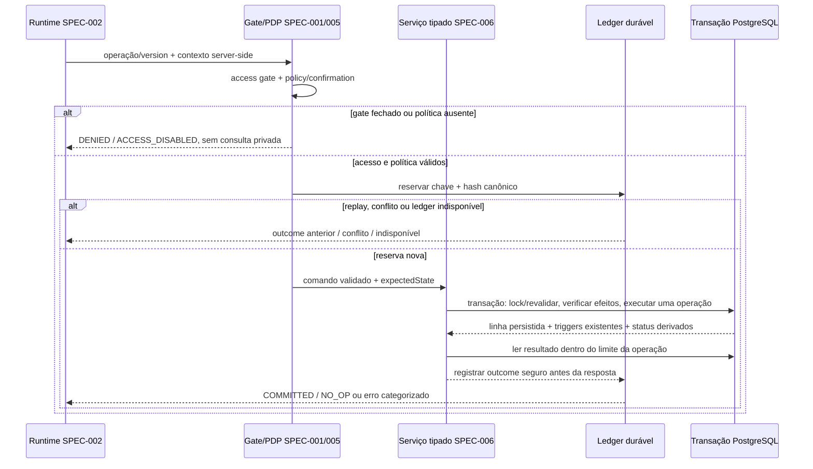

# Plano técnico: ferramentas de escrita e planejamento

**SPEC ID**: `SPEC-006` | **Versão**: `1` | **Manifest hash**: atribuído somente ao criar lote  
**Branch**: `main` preservada | **Data**: 2026-10-28 | **Spec**: [spec.md](spec.md)  
**Status**: Draft — arquitetura proposta; não autoriza implementação.

## Resumo

SPEC-006 define comandos tipados, unitários e server-side para criar/renomear demanda, tarefa e subtarefa, alterar alocação semanal/diária e mudar status de subtarefa. Os comandos usam as tabelas, constraints e triggers existentes. SPEC-004 continua dona de consultas; SPEC-002 do grafo/executor/ledger; SPEC-005 do gate, política e confirmação. O LLM nunca recebe SQL, nomes de tabelas/colunas ou um caminho genérico de update.

Um handler futuro só executa depois do gate DEC-001, validação de alvo/pai, política de SPEC-005, confirmação segundo a matriz que venha a ser aprovada e reserva idempotente. Status dos pais e os efeitos de agenda dos triggers são lidos de volta. A abertura do gate DEC-001, a matriz DEC-009 e o adaptador transacional permanecem pendências explícitas. A matriz de confirmação neste planejamento é uma proposta para revisão, não uma decisão aprovada.

## Contexto técnico

**Linguagem/runtime**: JavaScript ESM e Node.js nos módulos server-side propostos. Runtime/API e região dependem de DEC-010 e da SPEC-002; nenhum endpoint é criado nesta fase.  
**Dependências existentes**: `@supabase/supabase-js` e `node:test` já presentes. Nenhuma dependência nova.  
**Persistência de domínio**: `public.demandas` e triggers PostgreSQL existentes. `public.recorrente` fica sob SPEC-007. Nenhuma alteração de tabela, status, trigger, grant ou RLS nesta SPEC.  
**Transação/idempotência**: contrato exige um limite transacional e ledger durável; adaptador/armazenamento não estão selecionados. Supabase REST em várias chamadas não pode ser apresentado como uma única transação. Funções tipadas PostgreSQL/RPC com `SECURITY INVOKER` e grants explícitos são a recomendação técnica para avaliar; conexão transacional server-side é alternativa dependente do runtime.  
**Testes**: `npm test`, `npm run lint`, `npm run build`; doubles sintéticos, contratos de repository/ledger e testes de banco em alvo isolado. Nenhum teste foi executado neste trabalho documental.  
**Metas**: não há metas numéricas de latência nem limite de abuso aprovado; limites vêm de SPEC-002/DEC-012.  
**Restrições**: DEC-001 bloqueia todo read privado e write real até o gate ser aprovado, implementado e verificado. Não usar passkey client-side, `anon` grants, Secret/service_role ou confirmação como autorização do proprietário. Não habilitar exclusão, edição de templates, status direto do pai ou workflows parciais.

## Verificação da Constituição

| Princípio | Avaliação do plano |
|---|---|
| I. Preservar comportamento | Usa regras/colunas/triggers atuais; não muda as páginas React/Vite nem o fluxo client-side existente. |
| II. Escopo controlado | O plano e a matriz são Draft. Não aprova SPEC, batch, DEC-009 ou runtime. |
| III. Segurança e dados | Gate DEC-001 primeiro; ferramenta allowlisted; sem SQL do LLM, sem segredo/client privileged, erros e logs redigidos. |
| IV. Testes acompanham desenho | Cada história inclui unitários, contrato e integração sintética; concorrência/rollback usam alvo isolado. Resultado real só será marcado com evidência. |
| V. Execução durável | Idempotência exige ledger durável e outcome consultável; nada é persistido no schema SDD por esta SPEC. Retenção ainda não decidida. |
| VI. Correção limitada | Limites de 5 tentativas/120 minutos e pausa global permanecem inalterados no `$sdd-run` futuro. |
| VII. Mudanças pequenas | Serviços server-side estreitos; nenhum domínio duplicado; nenhum schema ou código modificado nesta fase. |
| VIII. Publicação manual | Não há commit, push, merge ou deploy autorizado. |

**Gate pós-desenho**: planejamento compatível. A ativação real continua bloqueada por DEC-001 e DEC-009, pelo ledger durável e pela escolha aprovada de transação/API.

## Arquitetura e contratos

### Limites de módulo

1. `server/agent/tools/` declara nomes/versões e schemas estritos, consumidos por SPEC-002. Registry de produção permanece sem capability privada enquanto DEC-001 estiver fechado.
2. `server/domain/write/` valida relações/status/planejamento e transforma comandos em operações tipadas. Não monta SQL do LLM nem implementa consultas abertas.
3. `server/agent/guardrails/` (SPEC-005) aplica acesso, autorização, grant e idempotência no executor, imediatamente antes do efeito.
4. `MutationRepository` abstrai a operação transacional. O adapter deve revalidar alvos/precondições, executar uma operação, deixar triggers existentes aplicarem regras, e ler valores/status resultantes antes de responder.
5. Leituras para busca e contexto pertencem a SPEC-004. SPEC-006 não implementa um read tool paralelo; preview usa somente os dados tipados necessários e protegidos pelo mesmo gate DEC-001.

### Sequência de uma escrita



O diagrama é uma proposta. Se o ledger não puder ser atomicamente associado à escrita nem recuperar resultado incerto, a capability permanece desabilitada. Não prometer “exactly once” só com um `Idempotency-Key` em memória.

### Contratos de operação

Os nomes/DTOs completos estão em [contracts/write-tools.md](contracts/write-tools.md). Operações previstas: `create_demand`, `create_task`, `create_subtask`, `rename_demand`, `rename_task`, `rename_subtask`, `set_weekly_allocation`, `set_daily_subtask_schedule` e `set_subtask_status`. Cada uma tem schema próprio, ID decimal persistente, campos permitidos exatos e resultado normalizado.

- Tipo e parent não são editáveis. Status direto de demanda/tarefa é negado; o trigger é autoridade.
- Sem tarefa, demanda pode receber data semanal; demanda com tarefa não. Tarefa recebe data semanal; subtarefa não é item semanal.
- Subtarefa diária usa uma data na mesma semana de calendário Monday–Sunday da tarefa, e `hora_inicio < hora_fim`. A agenda só é alterada quando os três campos são válidos juntos ou todos são limpos.
- Overlaps continuam permitidos pela regra existente; resultado não desloca/substitui outra atividade.
- `NO_OP` retorna sem nova alteração. Nome repetido não é bloqueado por dedupe; alvo desconhecido/ambíguo não é escolhido por semelhança.
- `COMMITTED` exige read-back de ID, campos salvos e status derivados. Erros de constraint, conflito stale, policy, confirmation ou dependência não podem ser relatados como sucesso.

### Transação, conflitos e idempotência

O estado atual não tem coluna de revisão, timestamp de update ou unique key de comando. A proposta calcula fingerprint dos campos relevantes no preview; ao confirmar, revalida registros e o conjunto de side effects. Alteração do snapshot retorna `CONFLICT`, exige nova proposta e não grava. Locks/ordem de locks ficam dentro do adapter de transação escolhido; não introduzir coluna de revisão neste escopo.

`idempotencyKey` é server-side e vinculado ao hash canônico de operação, versão, alvo, payload e precondições. Mesmo par chave/hash devolve o outcome anterior; mesma chave com hash distinto é conflito; chamadas concorrentes não executam duas vezes. Timeout depois de possível commit consulta ledger; sem estado conclusivo, outcome é `uncertain`, sem retry cego ou mensagem de sucesso.

Os triggers fazem parte da unidade atômica:

- criar tarefa sob uma demanda alocada pode limpar a data semanal do pai;
- mover uma tarefa pode limpar data e horas de subtarefas fora da semana de destino;
- mudar status de subtarefa recalcula status de tarefa/demanda.

O preview/confirmation proposta inclui IDs e antes/depois desses efeitos. Durante execução, a função/transaction revalida o conjunto exato; qualquer alteração invalida a confirmação. Ver [contracts/confirmation-matrix-proposal.md](contracts/confirmation-matrix-proposal.md): confirmação efetiva segue DEC-009 e permanece pendente.

### Privacidade, Supabase e Vite

- Nenhum acesso privado, preview, execução ou endpoint funciona com gate DEC-001 fechado. A passkey existente e permissões `anon` atuais não são autorização do servidor.
- O LLM chama somente ferramenta nomeada; nenhuma ferramenta aceita SQL, tabela, coluna ou operador arbitrário.
- Não usar `SECURITY DEFINER` ou `service_role` para contornar RLS/autenticação. A função/RPC proposta deve ser invoker, com grants explícitos mínimos e sem execução pública; a configuração real aguarda um controle separado que satisfaça a condição de DEC-001 e o projeto de acesso aprovado.
- Módulos de domínio e DB ficam fora de `src/` e do grafo React/Vite. `api/` é reservado ao adaptador HTTP escolhido por SPEC-002/DEC-010, não a helpers genéricos descobertos como rotas.
- Metadados de log incluem apenas correlation ID, operação/versão, categoria, duração e estado idempotente. Não registrar nomes, payloads, prompts, resultado bruto ou SQL.

## Plano de execução proposto

1. Fechar DTOs, fixtures sintéticas, enums e outcomes; estabelecer `MutationRepository`/ledger ports e default deny.
2. Implementar create/rename com validação de hierarquia e testar o efeito do trigger ao criar tarefa sob demanda alocada.
3. Implementar alocação semanal/diária com preview, expected state e contrato transacional; incluir effects de mover tarefa.
4. Implementar status de subtarefa e read-back dos estados derivados de tarefa/demanda.
5. Integrar SPEC-005 grant/policy e SPEC-002 idempotency; executar replay, concorrência, rollback e falha ambígua em alvo isolado.
6. Integrar API somente após gates; verificar build do frontend separado, nenhuma capability real com acesso fechado e evidência por critério.

As fases são dependentes. Testes unitários de schemas e regras puras podem ser paralelos em arquivos distintos após fixtures estáveis; criação de tarefas e movimentos de agenda compartilham estado/adapter e ficam sequenciais. Nenhuma delegação está planejada para este planejamento; paralelismo futuro exige atribuições e escopos de arquivo disjuntos gravados pelo fluxo SDD aprovado.

## Quality gates

| Gate futuro | Evidência exigida |
|---|---|
| Unitário | DTO, IDs, hierarquia, enum, horários, fingerprints e outcomes por fixtures sintéticas. |
| Contrato | tool schema, repository, transaction/ledger ports, normalização de SQLSTATE e replays. |
| Banco isolado | constraints/triggers reais em target não produtivo; atomicidade, rollback e leitura de status derivado. |
| Concorrência | mesmo idempotency key concorrente; edição stale; lock/reserva; no máximo um efeito. |
| Segurança | gate fechado implica zero calls privadas; policy/confirmation falham fechadas; nenhum SQL arbitrário; nenhuma key no bundle. |
| Geral | `npm run lint`, `npm run build`, `npm test`; cada comando deve registrar saída/exit code reais. |

Nenhum gate foi executado neste trabalho documental.

## Decisões e riscos

| Item | Estado | Efeito |
|---|---|---|
| Condição de acesso imposta por DEC-001 | DEC-001 está aprovada; o controle separado que satisfaça a condição ainda não foi escolhido nem implementado | Bloqueia todos os endpoints privados, previews com dado privado e writes reais; esta linha não aprova mecanismo de acesso. |
| Matriz DEC-009 | Pendente; proposta por operação em contrato separado | Nenhum write usa a matriz proposta como policy de produção. |
| Transação DB / schema e grants | Proposta: operation functions/RPC invoker; alternativa: conexão transacional server-side | Runtime/credencial/role dependem de DEC-001/010; sem atomicidade, movimentos com triggers ficam desabilitados. |
| Ledger idempotente | Porta existe na SPEC-002; storage e acoplamento atômico ainda precisam de definição | Sem reserva/read-back durável, negar e não repetir após estado incerto. |
| Nomes duplicados | Schema permite | Usar ID; não criar unique constraint nem dedupe sem decisão. |
| Triggers existentes | Autoridade de integridade | Se os testes futuros descobrirem comportamento não transacional/derivado incompatível, não alterar trigger em silêncio; retornar para revisão de escopo. |
| Dados e logs | DEC-005 pendente para retenção ampliada | Manter só referências/resultados mínimos; não escolher prazo de retenção. |

## Entrada e conclusão

**Entrada de implementação**: SPEC-006 na versão exata em lote aprovado e admitido pelo `$sdd-run`; SPEC-001/002/004/005 compatíveis; DEC-001 permanece aprovada como decisão de manter a passkey existente sem autenticação nova, enquanto o controle de acesso separado que possa satisfazer seu gate precisa ser decidido, implementado e verificado; DEC-009 aprovada para as operações habilitadas; mecanismo transacional e ledger durável avaliados, com grants/retenção aplicáveis aprovados. Esta entrada não aprova uma solução de acesso. Até que todas as condições sejam satisfeitas, capabilities reais permanecem fora do registry.

**Conclusão**: cada operação habilitada tem testes positivos, negativos, stale-state, replay e read-back; todos os effects do trigger aparecem no preview e outcome; status dos pais bate com a regra existente; nenhuma escrita não autorizada ou parcial passa; exclusão continua indisponível; gates têm evidência real e nenhum teste planejado é marcado como concluído.

## Estrutura proposta

### Documentos desta SPEC

`specs/SPEC-006/{spec.md,plan.md,research.md,data-model.md,quickstart.md,tasks.md}`, `contracts/{write-tools.md,confirmation-matrix-proposal.md}` e `checklists/requirements.md`.

### Caminhos de fonte futuros (não criados)

```text
server/agent/tools/write-capabilities.js
server/domain/write/{contracts,validation,commands,outcomes,repository,idempotency}.js
server/domain/write/{hierarchy,planning,status}.js
tests/fixtures/domain-write/{commands,confirmation,ledger}.js
tests/unit/domain-write/{contracts,hierarchy,planning,status,outcomes}.test.js
tests/contracts/domain-write/{repository,transaction,ledger}.test.js
tests/integration/domain-write/{hierarchy,planning,status,replay,concurrency}.test.js
supabase/migrations/  (somente se o adaptador transacional escolhido exigir objeto novo e a SPEC/lote autorizar)
```

**Decisão estrutural**: cada capability tem owner no domínio; HTTP/runtime ficam com SPEC-001/002; queries ficam com SPEC-004. Nenhum dos caminhos acima foi criado nesta fase, exceto documentos da SPEC.

## Acompanhamento de complexidade

| Elemento | Justificativa |
|---|---|
| Transaction/ledger ports | Necessários porque um write pode disparar efeitos em linhas filhas e precisa ser idempotente sob retry/concorrência. O adapter concreto continua proposta. |
| Preview de efeitos indiretos | Necessário para confirmação exata e para evitar apagar agendas que não foram mostradas ao usuário. |
| Caminhos server-side | Necessários para integrar com SPEC-002 sem incluir domínio/segredos no bundle Vite. |
