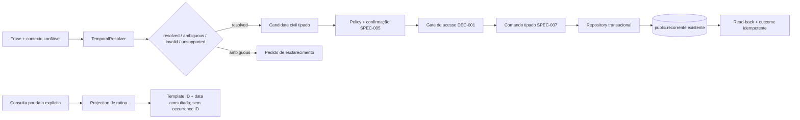

# Plano técnico: interpretação temporal e recorrências

**SPEC ID**: `SPEC-007` | **Versão**: `1` | **Manifest hash**: atribuído apenas ao criar lote  
**Branch**: `main` preservada | **Data**: 2026-10-28 | **Spec**: [spec.md](spec.md)  
**Status**: Draft — arquitetura proposta; não autoriza implementação.

## Resumo

SPEC-007 separa a interpretação de linguagem temporal da persistência civil e da série de rotinas. O resolver futuro recebe uma frase, um instante de referência confiável e o fuso fixo aprovado `America/Cuiaba`; retorna valor resolvido, ambiguidade, entrada inválida ou interpretação não suportada. O módulo de recorrência valida e consulta a série `public.recorrente` e projeta, para uma data selecionada, um bloco de leitura sem criar identidade persistida de ocorrência.

DEC-003 está aprovada. DEC-013 continua pendente para semântica de dia da semana sem data e “próxima semana”, tanto em consulta quanto em gravação. DEC-004 continua pendente para exceções individuais. DEC-009 continua pendente para confirmação de gravações. Nenhuma dessas pendências é convertida em regra aprovada. As consultas privadas e gravações de série permanecem fechadas pelo requisito de segurança da DEC-001 até que um controle de acesso separado seja aprovado, implementado e verificado.

## Contexto técnico

**Linguagem/runtime candidato**: JavaScript ESM no lado servidor; a versão/runtime definitivo depende de DEC-010.  
**Dependências**: `Intl.DateTimeFormat`/ICU disponíveis no Node são a primeira opção a avaliar; a API `Temporal` ou polyfill só será usada após spike de compatibilidade e aprovação de dependência. Nenhuma biblioteca de parsing é selecionada nesta SPEC.  
**Persistência**: manter `public.recorrente` e `public.demandas` exatamente como estão. Não criar colunas, exceções, ocorrências ou tabela de compromisso.  
**Testes existentes**: `npm test` usa `node --test`; existe teste de timeline diária, sem parser ou timezone fixtures. Não há teste E2E declarado. Nenhum teste foi executado durante este planejamento.  
**Limites**: nenhum acesso a dados privados, endpoint ou escrita de rotina enquanto DEC-001 não estiver satisfeita. A passkey client-side, confirmação e grant `anon` não são autorização server-side.

## Alinhamento com a Constituição

| Princípio | Aplicação neste plano |
|---|---|
| I. Preservar comportamento | Mantém tabelas, colunas civis, regras de semana Monday–Sunday, intervalos sobrepostos e visualização read-only existente. |
| II. Escopo controlado | Parser, adapter de timezone, operações de série e escolhas de runtime são propostas Draft; sem nova entidade ou exceção aprovada. |
| III. Segurança e dados | Reads privados e writes falham fechados; nenhuma chave no bundle Vite, SQL do modelo, prompt em log ou dado privado enviado a provedor. |
| IV. Testes acompanham o desenho | Fixtures fixas, testes de fronteira, timezone/TZDB, round trip e DB isolado com dados sintéticos. Pass só com saída real. |
| V. Execução durável | Replays usam o ledger/contratos de SPEC-002/006; não introduzir armazenamento ou retenção. |
| VI. Correção limitada | Limites de 5 tentativas/120 minutos e pausa global do runner permanecem com o SDD futuro. |
| VII. Mudanças pequenas | Módulos server-side isolados; nenhum schema, UI, API ou código é alterado neste planejamento. |
| VIII. Publicação manual | Nenhum commit, push, merge ou deploy. |

## Inventário do modelo existente

O contrato de dados está detalhado em [data-model.md](data-model.md). O ponto central é que `public.recorrente` representa uma série. Os dias ISO 1–7, datas inclusivas e horário local descrevem quando o template se aplica. A projeção para um dia é efêmera e identificada pela combinação do template persistente com a data consultada; não é uma ocorrência persistida.

`hora_fim` pode ser nula no schema. O fallback de uma hora em `src/lib/recurringTime.js` serve à visualização atual e não é duração armazenada. O contrato novo preserva `null` e não infere duração. A restrição PostgreSQL aceita `hora_fim is null or hora_fim > hora`; rotinas que cruzam meia-noite não são representáveis por essa regra e devem ser recusadas/clarificadas, sem ajuste automático.

## Arquitetura proposta



O fluxo de escrita só fica ativo depois dos gates. Parsing de frase fornecida pelo usuário pode ser testado com fixtures sem acesso ao banco. Consulta de recorrência exige read privado e, portanto, também fica bloqueada pelo gate DEC-001.

### Limites de módulo propostos

| Caminho futuro | Responsabilidade | Dono/integração |
|---|---|---|
| `server/domain/temporal/contracts.js` | DTOs, resultado discriminado e motivos de ambiguidade. | SPEC-007; consumido pelo runtime SPEC-002. |
| `server/domain/temporal/resolve.js` | Resolver puro com instante de referência, locale `pt-BR`, `America/Cuiaba` e adapter de timezone injetável. | SPEC-007; sem `Date` implícito do host e sem chamadas externas. |
| `server/domain/temporal/timezone.js` | Operações de conversão instant ↔ data/hora civil e identificação de gap/fold. | SPEC-007; implementação concreta depende de DEC-010 e spike de compatibilidade. |
| `server/domain/recurrence/validate.js` | Validação de weekday único, intervalo civil e campos permitidos. | SPEC-007; usa constraints atuais como autoridade final. |
| `server/domain/recurrence/series.js` | Comandos de criar/editar série e projeção read-only para data selecionada. | SPEC-007; nenhuma identidade de ocorrência. |
| `server/domain/recurrence/repository.js` | Interface tipada para query por dia e mutação transacional de série. | SPEC-007; sem SQL livre nem seleção arbitrária do LLM. |
| `server/agent/tools/temporal.js` | Schemas nomeados para interpretar/queryar/mutar; capability protegida começa desabilitada. | SPEC-007 declara contrato; SPEC-002 registra/executa; SPEC-005 autoriza. |
| `tests/fixtures/temporal/` e `tests/fixtures/recurrence/` | Frases sintéticas, timestamps fixos, casos IANA e séries sintéticas. | Testes, sem dados privados. |

Os caminhos são propostas e não existem atualmente. API/HTTP e provider são de SPEC-001/002. SPEC-004 continua dona das consultas transacionais de demandas/subtarefas; SPEC-007 não cria consulta paralela para essas entidades. SPEC-006 fornece comandos e idempotência para agenda de demandas; SPEC-007 não reaplica nem duplica seus writes.

### Contrato temporal

- Entrada contém `phrase`, `locale`, `referenceInstant` em ISO 8601 com offset/`Z`, `timeZone: "America/Cuiaba"` e, quando o chamador tiver contexto, a intenção (`query`, `schedule`, `reschedule` ou `series`). O instante é server-side confiável; o modelo não escolhe o timezone nem o relógio.
- Resultado tem estado `resolved | ambiguous | invalid | unsupported`, frase original, instante de referência, locale, timezone, valores civis (`date`, `startTime`, `endTime`), eventual instant explícito normalizado e lista limitada de motivos. Campos não aplicáveis ficam `null`; não sintetizar duração.
- “Hoje” e “amanhã” derivam da data civil em Cuiabá no instante de referência. Amanhã é o próximo dia civil, não `referenceInstant + 24h`.
- Data ISO explícita é uma data civil. Horário local sem offset é `time without time zone`. Um timestamp ISO com offset identifica um instant; converter o instant pelo zone rules para produzir data/hora civil.
- Dia da semana sem data e “próxima semana” usam estado `ambiguous` até DEC-013 ser aprovada, para consulta e gravação. Não selecionar a regra anterior proposta como default.
- Horário inexistente/repetido segundo regras IANA resulta em clarification/ambiguity; nenhuma opção anterior/posterior é escolhida automaticamente.
- Datas de exibição/confirmação com hora incluem `America/Cuiaba`. A persistência mantém `date` e `time without time zone`, sem UTC shift.

### Contrato de série e projeção

- Input de série especifica `name`, conjunto de weekdays ISO, `startDate`, `endDate`, `startTime` e `endTime|null`; IDs bigint são strings decimais. Nome segue o constraint existente (trim não vazio), sem máximo/unicidade inventados.
- Dias são únicos na entrada, apesar de o check PostgreSQL atual validar cardinalidade e faixa sem remover duplicatas. A série tem `data_inicial <= data_final`; as duas datas são inclusivas.
- `endTime=null` permanece nulo. Quando informado, precisa ser maior que `startTime`, compatível com constraint existente. Intervalo passando da meia-noite é rejeitado até que modelo/semântica futura o suporte.
- Aplicabilidade a uma data resulta de weekday ISO da data e `startDate <= date <= endDate`. Resultado read-only contém `templateId`, `selectedDate`, título, weekdays e horários. Não inclui ID de demanda/subtarefa ou ocorrência persistida.
- Overlap de rotina e agenda é informativo; não negar nem mover por colisão. A timeline pode mostrar overlap, de acordo com comportamento existente.
- Editar uma série altera a faixa/weekday/horário da série inteira no escopo de dados representável. Não prometer skip, edição de ocorrência, feriado, pausa/retomada, cancelamento ou restauração individual; DEC-004 continua pendente. Exclusão de template fica fora da capability até aprovação de escopo/política aplicável.

## Integração, transação e segurança

O modelo só devolve DTO temporal. O runtime valida estrutura e intenções; SPEC-005 trata texto recuperado como não confiável, aplica policy e confirmação; o repository executa somente operações nomeadas. Não aceitar SQL, filtro, coluna, enum ou timezone fornecido pelo LLM. A execução de uma mutação de série deve ser idempotente conforme SPEC-002/006, revalidar fingerprint/target, gravar em um limite transacional aprovado e ler o valor persistido. Falha de confirmação, acesso, dependência, conflito ou leitura de retorno nunca responde sucesso.

DEC-009 é pendente. [contracts/confirmation-proposal.md](contracts/confirmation-proposal.md) é proposta para revisão apenas. Nenhum `confirmationRef` autentica o proprietário. Enquanto DEC-001 não tiver seu requisito de acesso adequado satisfeito por controle separado aprovado/implementado/verificado, ferramentas de consulta privada e mutação ficam fora do registry e fazem zero chamada ao repository. Não usar `anon`, passkey client-side, `service_role` ou Secret para contornar o gate.

Logs futuros: correlation ID, operation/version, resultado categorizado, duração, timezone/tzdb version de execução e fixture ID; sem frase original, nome de rotina, payload, prompt, linhas, SQL, credenciais ou dados privados. Tracing externo e retenção dependem DEC-005/006/010.

## Dependências, pendências e riscos

| Item | Estado | Efeito no escopo |
|---|---|---|
| DEC-001 | Aprovada; acesso adequado server-side não foi selecionado | Bloqueia query privada e todas as mutações reais. Não escolher mecanismo nesta SPEC. |
| DEC-003 | Aprovada | Fixa `America/Cuiaba` e persistência civil; não está pendente. |
| DEC-004 | Pendente | Bloqueia exceções de ocorrência; não bloqueia consulta/criação/edição de série dentro do escopo e gates. |
| DEC-009 | Pendente | Bloqueia matriz de confirmação; manter qualquer matriz apenas como proposta. |
| DEC-010 | Pendente | Runtime/região não definidos; bloqueia pinagem de Node/ICU/TZDB e deployment target. |
| DEC-013 | Pendente | Bloqueia resolução silenciosa de weekday sem data e “próxima semana” em queries/writes. |
| SPEC-001/002/004/005/006 | Draft | Contratos de API/runtime/leitura/policy/mutação/idempotência devem permanecer compatíveis antes da implementação. |

Riscos técnicos principais: versões de TZDB/ICU diferem por runtime; o browser atual usa calendário local; a UI de recorrência apresenta uma hora final derivada quando `hora_fim` é nula; o schema aceita duplicatas de weekday embora a UI evite; não há linha de ocorrência; o database não liga série a demanda; sobreposição não é uma falha de integridade; e o acesso anônimo atual não satisfaz o gate do agente.

## Plano de execução proposto

1. Fixar contratos e fixtures, separar civil date/time/instant e escolher uma interface de zone adapter sem adicionar dependência.
2. Implementar o resolver por valores explícitos e expressões não ambíguas com referência fixa; testes de ambiguity/gap/fold falham fechados.
3. Implementar validador e query pura da série por weekday ISO e faixa inclusiva; manter projeção read-only, sem occurrence ID.
4. Implementar create/edit transacional da série apenas depois de DEC-001, DEC-009 e adapters aprovados; não implementar delete, pause/resume ou exceções DEC-004.
5. Integrar com SPEC-002/004/005/006, rodar quality gates e avaliar fronteiras com fixtures sintéticas. DEC-013 permite habilitar a semântica de suas expressões depois de ser decidida; sem isso elas seguem pedindo esclarecimento.

Testes de parsing puro podem correr em paralelo com testes de série se fixtures compartilhadas estiverem estáveis e arquivos forem disjuntos. Os writes de série e testes do repository usam o mesmo adapter e devem permanecer sequenciais. Não há delegação definida neste plano; qualquer paralelismo futuro seguirá o escopo de arquivos e registro de atribuições do runner aprovado.

## Quality gates futuros

| Gate | Evidência exigida |
|---|---|
| Unitário temporal | Fixed reference instant, `pt-BR`, Cuiabá midnight, hoje/amanhã, date/instant, inválido/ambíguo, semanas/meses/anos. |
| IANA/runtime | Tzdb/ICU reportados; fixtures históricas de transições confirmadas com a versão testada; gap/fold sem shift. |
| Contrato série | Unicidade de dias na entrada, conjunto 1–7, nome não vazio, período inclusivo, `hora_fim` nulo ou > início. |
| Integração isolada | Queries de dias/range e create/edit de série com retorno de banco, replay/idempotência e stale-state; sem schema change. |
| Regras atuais | Overlap preservado; projeção não insere occurrence; data/time round-trip sem shift; nenhum subtask count muda. |
| Segurança | DEC-001 fechado = zero chamadas privadas; DEC-004 exceção negada; DEC-013 ambiguous pede clarificação; DEC-009 ausente nega write. |
| Geral | `npm test`, `npm run lint`, `npm run build`; registrar comando e resultado reais. |

Nenhum gate foi executado durante o planejamento.

## Entrada e conclusão

**Entrada de implementação**: SPEC-007@1 em lote explicitamente aprovado e admitido; SPEC-001/002/004/005/006 compatíveis; controle de acesso separado que satisfaça DEC-001 aprovado, implementado e verificado; runtime/TZDB testável selecionado sob DEC-010; DEC-009 aprovada para as mutações; contrato idempotente/transacional acordado. DEC-004 deve estar aprovada antes de adicionar exceções, e DEC-013 antes de resolver as frases pendentes sem perguntar. Estas condições não aprovam solução nesta SPEC.

**Conclusão**: cada SC tem evidência fixa e reprodutível; valores civis persistem iguais; consultas exibem somente projeções; nenhuma ocorrência/entidade/tabela foi criada; nenhuma ambiguidade é resolvida silenciosamente; nenhuma rotina se move para evitar overlap; capacidades fora do escopo continuam indisponíveis; resultados de gates não executados ficam `NOT VERIFIED`.

## Estrutura documental e caminhos futuros

Documentos: `specs/SPEC-007/{spec.md,plan.md,research.md,data-model.md,quickstart.md,tasks.md}`, `contracts/{temporal-resolution.md,recurrence-series.md,confirmation-proposal.md}` e `checklists/requirements.md`.

```text
server/domain/temporal/{contracts,resolve,timezone}.js
server/domain/recurrence/{validate,series,repository}.js
server/agent/tools/temporal.js
tests/fixtures/temporal/{relative,absolute,ambiguous,iana}.js
tests/fixtures/recurrence/{templates,overlaps}.js
tests/unit/temporal/{resolve,timezone}.test.js
tests/unit/recurrence/validate.test.js
tests/contracts/temporal/{resolver,series}.test.js
tests/integration/recurrence/{query,mutation,idempotency,access-gate}.test.js
```

Todos os caminhos de código são propostas e nenhum deles foi criado nesta fase documental.
