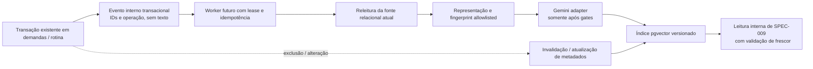

# Plano técnico: Gemini Embedding, pgvector e indexação incremental

**SPEC ID**: `SPEC-008` | **Versão**: `1` | **Manifest hash**: atribuído somente ao criar lote  
**Branch**: `main` preservada | **Data**: 2026-10-28 | **Spec**: [spec.md](spec.md)  
**Status**: Draft — proposta documental; não autoriza implementação, migração ou chamada externa.

## Resumo

Planejar um índice vetorial derivado, reconstruível e sincronizado com as tabelas relacionais existentes. Um feed transacional registra referências de origem; um worker lê o estado atual, cria uma representação estrutural allowlisted, solicita embeddings ao Gemini somente depois dos gates aplicáveis e grava uma geração versionada em pgvector. Deduplicação, versão de conteúdo, idempotência, atualização de metadados e invalidação de exclusões impedem que o índice ultrapasse a fonte de verdade.

O checkout não contém pgvector, embeddings, busca lexical, outbox ou worker do produto. O browser escreve diretamente nas tabelas existentes, por isso o feed precisa capturar essas transações sem exigir que uma tela futura seja a única produtora de eventos. Um trigger transacional é uma alternativa a avaliar, não DDL nem solução de privilégios aprovada. DEC-010 mantém runtime/fila pendentes. Nenhuma alteração de fonte, geração de embedding ou leitura externa de registro privado ocorre antes do gate DEC-001 e das decisões DEC-006/007/010/011.

## Contexto técnico

**Linguagem/runtime**: JavaScript ESM no servidor; runtime, versão Node, execução longa e região dependem de DEC-010.  
**Dependências primárias**: interface de provider Gemini e extensão PostgreSQL `vector`; nenhum SDK/modelo foi instalado ou selecionado.  
**Storage**: PostgreSQL Supabase atual como fonte relacional; tabelas privadas/aditivas de outbox e índice são somente desenho candidato.  
**Testes**: Node `node:test`; integração PostgreSQL em database isolado e provider substituto determinístico. Não executar smoke real nesta etapa.  
**Plataforma**: Vite/React existente e worker/API server-side futura ainda não escolhida.  
**Objetivos de desempenho**: medir atraso de sincronização, taxa de eventos pendentes, custo de reindexação e latência/qualidade em corpus sintético; números-alvo não aprovados.  
**Restrições**: não instalar modelo local pesado; não chamar Gemini; não indexar dados reais; não definir dimensão ou modelo (DEC-011); não pressupor habilitação do pgvector na base.  
**Escala**: corpus atual pequeno, predominantemente nomes curtos; o valor e a elegibilidade seguem DEC-007.

## Verificação da Constituição

| Princípio | Avaliação |
|---|---|
| Arquitetura existente | Preserva React/Vite, JavaScript, Supabase e Vercel; worker é somente contrato futuro sujeito a DEC-010. |
| Fonte de verdade | `public.demandas`/`public.recorrente` continuam autoritativas; índice é derivado e pode ser reconstruído. |
| Segurança | Gate DEC-001 e DEC-006/007/010/011 precedem leitura/envio privado. Chave Gemini nunca vai a `VITE_*`; `service_role` não é identidade do proprietário. |
| Modelo de domínio | Não cria evento/compromisso nem ocorrência recorrente persistida. Demanda → tarefa → subtarefa mantém os IDs existentes; rotina, se elegível, continua template separado. |
| Testes | Fixtures sintéticas, ambiente isolado, provider double, sem alteração de dados existentes. Qualquer gate não executado fica `NOT VERIFIED`. |
| Mudança mínima | Sem instalação, migration, configuração Supabase, extensão, função, outbox ou worker nesta etapa. |
| Publicação | Sem commit, push, merge ou deploy. |

## Dependências e contratos

- **Pré-requisitos documentais**: SPEC-001 (`access-control gate`) e SPEC-004 (`read-tools` e modelo de domínio); ambos permanecem Draft.
- **Downstream**: SPEC-009 consome chunks, metadados e versão do índice; a busca não é implementada aqui.
- **Fonte compatível**: `public.demandas(id bigint, demanda text, tipo smallint, raizid bigint, status, data_exec, hora_inicio, hora_fim)` e `public.recorrente(id bigint, demanda text, hora, dia_semana, data_inicial, data_final)` mais alterações multi-dia posteriores. Não há `updated_at` ou versão de origem confirmada.
- **Contratos novos propostos**: `contracts/source-chunk.md`, `contracts/outbox-worker.md`, `contracts/gemini-provider.md`. Nenhum endpoint de browser é adicionado.
- **Segurança**: qualquer leitura privada, indexação ou solicitação Gemini real fica fechada até DEC-001, DEC-006, DEC-007, DEC-010 e DEC-011 serem satisfeitas. A passkey e os grants `anon` existentes não formam autenticação do worker. Não conceder ao browser acesso a tabela/fila/vetor.
- **Segredos**: quando e se aprovados, a chave Gemini e credenciais de banco ficam apenas em configuração server-side protegida no runtime escolhido. Não registrar headers, conteúdo, chave, embedding ou payload bruto. A credencial de banco deve ter privilégio mínimo; nenhuma chave privilegiada substitui a autorização de acesso.
- **Banco/migrações**: qualquer extensão, tabelas, triggers, roles, índices e funções exigem SPEC/lote aprovado, migration revisada e ensaios isolados. Nenhuma migration específica é escolhida agora.
- **Fora de escopo**: `src/` do frontend, schema `sdd`, tabelas de domínio sem alterações aprovadas, dashboard e RAG de SPEC-009.

## Arquitetura proposta



1. **Captura atômica**: toda transação que muda uma fonte elegível deve inserir no mesmo commit evento com `sourceType`, `sourceId`, operação e identidade de evento. Uma trigger interna é a opção inicial a avaliar porque páginas atuais escrevem direto com `supabase-js`; alternativa por outbox no serviço exige migrar todas as escritas e não cobre o estado atual. A implementação da trigger precisa demonstrar isolamento de schema, grants e RLS sem expor outbox e sem abrir acesso a dados privados. Se isso exigir privilégio que viole a postura aprovada, parar e trazer a alternativa para decisão; não conceder acesso direto à role `anon` nem criar endpoint privado antes do gate.
2. **Payload enxuto**: evento guarda referência e operação; worker relê a versão atual. Não guardar texto, segredo, prompt nem conteúdo do provider no evento. A exclusão gera tombstone por identidade estável mesmo quando a linha já não existe.
3. **Worker independente**: runtime não é definido. Consumidor aplica lease/claim, lock lógico por `(sourceType, sourceId, embeddingVersion)`, idempotência por event ID e fingerprint, tempo/retry limitados por configuração aprovada e dead-letter redigida. Supabase Queues/pgmq e polling de outbox permanecem alternativas DEC-010; mensagem duplicada e at-least-once são assumidos pelo contrato.
4. **Leitura e representação**: consulta tipada à fonte relacional, valida elegibilidade e reconstrói a hierarquia. Gera uma unidade lógica por item de demanda/tarefa/subtarefa. Títulos vazios ou sem valor semântico são ignorados com motivo categórico. Rotina só entra como `routine_template` separado se DEC-007 aprovar; nunca gerar ocorrência ou compromisso.
5. **Provider**: adapter recebe texto canônico aprovado, sem IDs persistentes ou metadados desnecessários. Entrada real fica bloqueada por DEC-001/006/007; testes usam fake determinístico. A implementação consulta a documentação Gemini e configuração aprovadas no momento da execução, valida resposta e rejeita modelo/tarefa/dimensão divergentes antes de gravar.
6. **Persistência derivada**: grava geração de chunks/embedding somente depois de confirmar que a fonte/fingerprint ainda está atual. Chunks incompatíveis de modelos/dimensões diferentes nunca participam da mesma busca ativa.
7. **Freshness**: resultados só são utilizáveis por SPEC-009 depois de validar a existência, elegibilidade, versão e hierarquia atuais. Exclusão ou mudança de elegibilidade invalida candidatos imediatamente pela validação da fonte, sem aguardar a fila.

## Representação e atualização seletiva

O fingerprint de entrada de embedding e o fingerprint de metadados são independentes. Proposta inicial para o corpus sintético compara dois templates: (a) tipo + nome do item, com cadeia de pais guardada somente como metadado; (b) tipo + nome + nomes da cadeia hierárquica. DEC-007 escolhe conteúdo e chunking. A segunda alternativa exige re-embedding de descendentes quando o texto de um ancestral mudar; a primeira exige apenas atualizar metadados/relacionamentos.

`status`, `data_exec`, `hora_inicio`, `hora_fim`, vigência e dias de rotina não entram no texto de embedding por padrão. Se usados como filtros pelo consumidor, seus valores são atualizados no projection metadata, e a alteração não chama o provider. Alteração de nome, tipo, parent ID ou qualquer campo incluído no template muda o fingerprint correspondente e só reindexa chunks afetados. Consulta exata desses valores continua com SPEC-004/PostgreSQL; metadata derivada não é autoridade.

Como o schema atual não declara `updated_at` ou revision, a versão candidata é hash estável de `sourceType`, ID, texto normalizado versionado, parent path conforme template e versão do template. O evento outbox identifica entrega/ordem; o worker consulta a origem atual antes de gravar, tornando evento antigo um no-op ou recalculando o fingerprint atual. Não adicionar coluna revision sem necessidade demonstrada e decisão explícita.

## Modelos, dimensões e índice

Na consulta à documentação oficial atual, Gemini API lista `gemini-embedding-2` (texto e modalidades adicionais; entrada até 8.192 tokens) e `gemini-embedding-001` (texto; até 2.048), ambos com dimensões de saída flexíveis de 128 a 3.072 e dimensões recomendadas documentadas de 768, 1.536 e 3.072. Os espaços são incompatíveis e a atualização de 001 para 2 exige re-embedding completo. O comportamento de `task_type`, agregação e normalização também difere; portanto, modelo, configuração de entrada, dimensão e template são parte de `embeddingVersion` e continuam pendentes DEC-011. Referência consultada: [Gemini Embeddings](https://ai.google.dev/gemini-api/docs/embeddings).

Supabase documenta pgvector `vector` indexável até 2.000 dimensões e `halfvec` até 4.000 em versões pgvector 0.7+, enquanto o tipo `vector` pode armazenar dimensões maiores sem necessariamente indexá-las com o índice ANN desejado. Assim, 3.072 dimensões do modelo não se encaixam automaticamente em HNSW `vector`; `halfvec` ou saída reduzida são alternativas que precisam de benchmark/compatibilidade. A extensão e versão instaladas no projeto não foram consultadas. Nenhuma dimensão, storage type, distance operator, HNSW/IVFFlat ou parâmetro de índice é selecionado. Referências: [Supabase vector indexes](https://supabase.com/docs/guides/ai/vector-indexes), [pgvector](https://github.com/pgvector/pgvector).

A documentação Supabase recomenda HNSW como opção geral robusta a mudanças, porém ANN troca exatidão por desempenho e pode sofrer recall menor com filtros seletivos. Corpus pequeno pode começar com busca exata/sem índice ANN. SPEC-009 deve comparar custo/recall e a estratégia só pode ser escolhida após dados sintéticos representativos e confirmação da extensão instalada. Não usar dimensões ou scores de gerações diferentes no mesmo espaço.

## Módulos e ownership proposto

| Caminho futuro | Responsabilidade | Limite |
|---|---|---|
| `server/indexing/domain/eligibility.js` | Allowlist/tipo e regra de skip. | Não define conteúdo externo aprovado por si só. |
| `server/indexing/domain/canonical-text.js` | Normalização, template versionado, fingerprints. | Nenhuma identidade/texto fora do allowlist. |
| `server/indexing/ports/source-repository.js` | Leitura de fonte/ancestrais atuais e metadata. | Somente server-side; gate DEC-001. |
| `server/indexing/ports/outbox.js` | Claim, ack, retry, tombstone e inspeção redigida. | Runtime/transporte dependem DEC-010. |
| `server/indexing/ports/embedding-provider.js` | Contrato provider independente. | Gemini real desligado até DEC-006/007/011. |
| `server/indexing/adapters/gemini.js` | Request/response Gemini; valida modelo/tarefa/dimensão. | Segredo server-side; nenhuma chamada nesta SPEC. |
| `server/indexing/services/index-worker.js` | Idempotência, freshness prewrite, retries e dead-letter. | Nenhum evento de domínio é executor de decisão. |
| `server/indexing/ports/vector-index.js` | Geração ativa, upsert/delete e validação de dimensão. | Storage e DDL não aprovados. |
| `server/indexing/observability/metrics.js` | Lag, contagens e divergência agregados. | Sem texto, vetor, chave ou prompt em logs. |
| `tests/fixtures/indexing/` | Corpus sintético e respostas provider determinísticas. | Sem cópia de dados do usuário. |

## Execução e recuperação

1. Fonte/outbox transacionam juntas; rollback da fonte também elimina o evento.
2. Worker adquire lease; concorrentes da mesma origem/version são serializados.
3. Worker relê a origem e constrói hash. Evento obsoleto converte-se em processamento do estado atual; não sobrescreve geração mais nova.
4. Se a fonte foi removida, perdeu elegibilidade ou mudou de hierarquia, marcar versão antiga indisponível e processar tombstone/metadata. SPEC-009 ainda revalida a fonte no momento da leitura.
5. Timeout, limite de taxa e falha temporária podem tentar novamente conforme limites a decidir. Resposta malformada, modelo/dimensão inesperada e entrada não permitida não gravam vetor; falha permanente ou tentativas esgotadas vai a DLQ com motivo codificado/redigido.
6. Replay mantém o mesmo `eventId`, `embeddingVersion` e fingerprint: resultado idêntico é no-op; fonte alterada leva ao fingerprint atual. Nunca reexecutar para uma geração de modelo desativada sem ação explícita.
7. Backfill usa cursor por ID, respeita worker/limites aprovados e pode retomar; não bloqueia escrita de domínio. Troca de modelo cria geração em paralelo, valida a nova geração e só então troca o ponteiro ativo. Retenção/remoção da geração antiga exige política operacional antes da produção.

## Decisões e riscos

| Decisão/r risco | Estado | O que bloqueia |
|---|---|---|
| DEC-001 gate de acesso | Aprovada como requisito; mecanismo ainda não escolhido. | Leitura privada, worker de produção e entrega de registros privados. |
| DEC-006 disclosure/redaction/localização | Pendente. | Enviar qualquer texto privado a Gemini ou observabilidade externa. |
| DEC-007 campos, chunking e valor semântico | Pendente. | Corpus/representação produtiva; pode concluir que embeddings não justificam uso. |
| DEC-010 runtime/região/filas | Pendente. | Worker, outbox operacional, limites de duração/conexão e procedimento de execução. |
| DEC-011 modelo/dimensão/troca | Pendente. | SDK/configuração de produção, tipo de coluna/index e geração compatível. |
| DEC-012 limites de chamadas/abuso | Pendente. | Política de contenção externa e volume de backfill; não há orçamento aprovado. |
| Versão pgvector do projeto | Não consultada. | Confirmar tipo/dimensão/index suportados antes de qualquer migration. |
| Corpus de títulos curtos | Risco alto de baixo ganho semântico. | Recomenda avaliação lexical/estruturada antes de autorizar custo/disclosure. |
| Captura outbox das escritas browser | Risco de cobertura e grants. | Exige desenho de trigger/CDC e revisão de segurança antes de alteração. |

## Quality gates futuros

| Gate | Método planejado | Evidência requerida |
|---|---|---|
| Lint | `npm run lint` | Worker/server-only compila sem código de segredo no cliente. |
| Build | `npm run build` | Bundle React/Vite não contém provider key, worker ou DB secret. |
| Unit | `npm test` com testes do indexer | Hash, template, filtros de metadata, versão/dimensão, out-of-order/idempotência. |
| Integração PostgreSQL | database isolado, fixtures sintéticas e fake provider | Commit/rollback outbox junto à origem; cascata, exclusão, retry, lease e replay. |
| Segurança | revisão de grants/schema/RLS/trigger e payload outbound capturado pelo fake | Nenhuma leitura privada sem gate; nenhuma informação extra enviada; nenhum endpoint/client com vetor. |
| Avaliação | corpus sintético português, fonte lexical/structured baseline, ablação sem embeddings | Ganho e custos medidos; thresholds só após aprovação. |

Nenhum desses comandos, testes, alterações de banco ou chamadas Gemini foi executado neste trabalho.

## Estrutura do projeto proposta

```text
specs/SPEC-008/
├── spec.md
├── plan.md
├── research.md
├── data-model.md
├── quickstart.md
├── contracts/
└── tasks.md

server/indexing/
├── domain/{eligibility,canonical-text,source-fingerprint}.js
├── ports/{source-repository,outbox,embedding-provider,vector-index}.js
├── adapters/gemini.js
├── services/index-worker.js
└── observability/metrics.js

tests/
├── fixtures/indexing/
├── unit/indexing/
├── contracts/indexing/
├── integration/indexing/       # database isolado + fake provider
└── security/indexing/

supabase/migrations/            # somente após SPEC/lote aprovado
```

**Decisão estrutural**: manter indexação no lado servidor em módulo separado da UI e das ferramentas de consulta; não criar função/worker ou migration no planejamento documental.

## Complexidade

| Área | Complexidade adicional | Justificativa |
|---|---|---|
| Outbox/CDC | Média/alta | Escritas atuais vêm de várias telas e precisam de evento transacional abrangente. |
| Gerações de vector | Média | Modelo/dimensão incompatíveis exigem coexistência e cutover reversível. |
| Worker/provider | Média | Falhas externas, limitação, retries e segredo server-only; runtime pendente. |
| Escopo de corpus | Baixa tecnicamente, alta como decisão | Títulos curtos podem não justificar embeddings nem envio a terceiro. |

Não há exceção de complexidade aprovada: schema, worker e integrações só poderão ser introduzidos por SPEC/lote autorizado.
