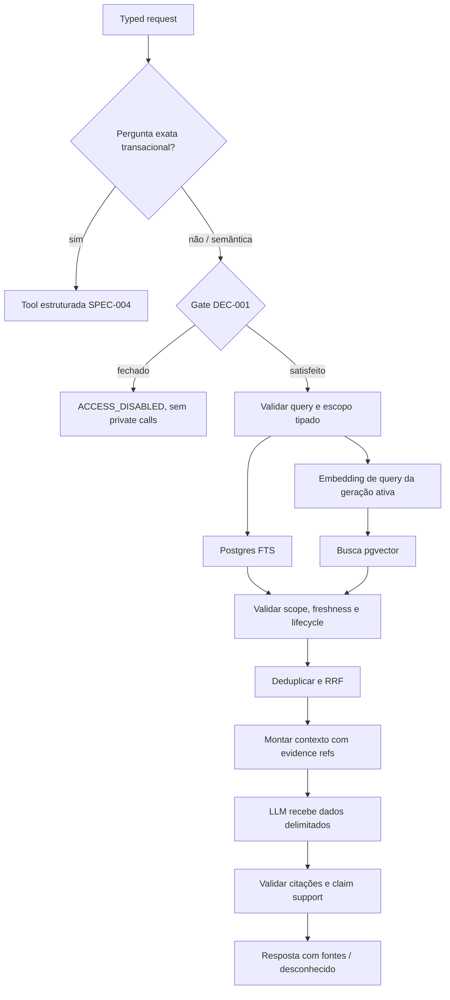

# Plano técnico: RAG híbrido, busca lexical/vetorial, RRF e grounding

**SPEC ID**: `SPEC-009` | **Versão**: `1` | **Manifest hash**: atribuído somente ao criar lote  
**Branch**: `main` preservada | **Data**: 2026-10-28 | **Spec**: [spec.md](spec.md)  
**Status**: Draft — proposta documental; não autoriza retrieval privado, provider ou alteração de banco.

## Resumo

SPEC-009 define busca semântica como uma ferramenta interna read-only para perguntas descritivas, que combina candidatos lexicais do PostgreSQL Full Text Search com candidatos vetoriais compatíveis da SPEC-008. RRF funde posições, não scores brutos. Antes de apresentar qualquer candidato, o pipeline aplica o mesmo escopo tipado, estado de exclusão e teste de frescor aos dois métodos. Resultados carregam proveniência, hierarquia e referências verificáveis para o grounding.

Fatos transacionais exatos — IDs, status, datas, horários, contagens, permissão ou alvo de escrita — continuam em ferramentas estruturadas da SPEC-004. Conteúdo recuperado nunca concede acesso nem instrui o agente. A ausência de autenticação server-side e as pendências DEC-006/007/010/011/012 mantêm retrieval privado e embeddings de query reais desabilitados. O RAG pode ser desnecessário para o corpus atual, composto principalmente por títulos curtos; sua utilidade precisa vencer uma avaliação sintética contra consulta estruturada e lexical antes de qualquer habilitação.

## Contexto técnico

**Linguagem/runtime**: JavaScript ESM e Postgres server-side futuros; runtime depende de DEC-010/SPEC-002.  
**Dependências**: contratos de leitura SPEC-004, guardrails SPEC-005, índice/versionamento SPEC-008 e runtime/modelo SPEC-002; nenhuma implementação de retriever existe no checkout.  
**Storage**: `public.demandas` como fonte relacional atual, rotina `public.recorrente` somente se permitida por corpus DEC-007; `pgvector`/Full Text Search ainda não configurados em migrations do produto.  
**Testes**: Node `node:test`, corpus/rótulos sintéticos, adapter de embeddings e LLM substitutos determinísticos, PostgreSQL isolado.  
**Objetivos mensuráveis já na SPEC**: pelo menos 95% de roteamento de pergunta exata para ferramenta estruturada; Recall@5/MRR contra baseline aprovado; 100% de frescor/citações nos fixtures definidos. Não inventar limiar de confiança, latência, custo ou melhoria adicional.  
**Restrições**: sem provider privado, chamada de modelo, SQL gerado pelo LLM, atualização de domínio, dado real em teste externo, dimensão/modelo escolhido ou alteração de grants.  
**Corpus**: demanda/tarefa/subtarefa; rotina-template é entidade separada e só pode ser incluída se DEC-007 aprovar. Nada cria compromisso/ocorrência.

## Constituição e decisões aprovadas

| Regra | Consequência para SPEC-009 |
|---|---|
| DEC-001: proprietário único e passkey atual, sem autenticação nova nesta etapa. | ID, filtro de hierarquia e passkey do browser não autorizam leitura server-side. Gate fechado antes de ambos os retrievers e do contexto. Nenhuma identidade/tenant adicional. |
| DEC-002: entidades existentes somente. | Resultados mantêm `demandas` e `recorrente` conforme tipo atual; sem evento, compromisso, occurrence ou outra entidade transacional. |
| DEC-003: `America/Cuiaba`. | Filtros temporais usam datas/horas civis existentes; RAG nunca converte/decide um horário exato. |
| DEC-006/007/010/011/012 pendentes. | Nenhuma consulta privada a Gemini, retrieval privado ou ativação produtiva até resolver dados externos, corpus, runtime, modelo e contenção de uso. |
| DEC-008/DEC-009 | Não são reabertas; dashboard e confirmação ficam fora desta SPEC. |

## Dependências e contratos

- **SPEC-002** fornece runtime/tool registry; embeddings de query usam mesma versão compatível de SPEC-008 e limites de provider/runtime aprovados.
- **SPEC-004** fornece typed reads para exact facts; SPEC-009 não define nem substitui SQL relacional autoritativo.
- **SPEC-005** define guardrails/política de ferramenta; retrieval não pode dar capacidade de escrita nem alterar autorização.
- **SPEC-008** fornece vetor, chunk, sourceRef, fingerprint, geração e invalidation/freshness. SPEC-009 não gera/indexa conteúdo de domínio.
- **Contrato novo proposto**: `contracts/retrieval-fusion.md` define typed request, canais, RRF e degradação; `contracts/grounding-evaluation.md` define citações, evidência e testes.
- **Security boundary**: execução interna futura server-side; sem endpoint de browser nesta SPEC. Gate DEC-001 precede qualquer read. Keys, query embedding e fontes não entram em bundle/logs. Não usar `anon`, passkey client-side ou `service_role` como autenticação do proprietário.
- **Banco**: opções futuras para FTS são GIN em expressão/coluna `tsvector` sobre campos aprovados; mudança depende migration/lote autorizado. Vector query usa a geração ativa SPEC-008. Nenhuma função SECURITY DEFINER, view, grant, index ou migration é aprovada aqui.
- **Fora de escopo**: browser UI, alteração de fonte, mutações, criação de entidade, cross-thread conversation retrieval, SQL livre, Tavily, seleção de modelo/dimensão e decisões de retenção.

## Arquitetura proposta



### Roteamento de perguntas

Classificação escolhe apenas contrato tipado e server-defined, nunca SQL ou nome de tabela/coluna fornecido pelo modelo.

| Tipo de pergunta | Caminho obrigatório |
|---|---|
| ID, status atual, data/faixa, horário, contagem, permissão ou identificação do alvo de mutação | Consulta relacional estruturada SPEC-004. Vetor/RAG não é autoridade. |
| Tema, descrição aproximada, expressão sinônima ou busca por itens relacionados | Pode acionar canais lexical e vetorial se gates e corpus permitirem. |
| Pedido misto | Separar afirmações exatas (SPEC-004) de descoberta semântica; preservar provenance por parte. Se a intenção ou campo exato não estiver claro, pedir esclarecimento. |

Um acerto lexical ou vetor parecido não prova o status atual nem seleciona item para escrita. Para respostas mistas, a resposta identifica fatos consultados relacionalmente versus candidatos semânticos.

### Lexical retriever

- Constrói a `tsquery` a partir de texto de usuário com função Postgres tolerante como `websearch_to_tsquery(config, text)` e parâmetros vinculados. Nunca concatenar texto em SQL/`to_tsquery` como gramática ou permitir SQL gerado.
- Indexa somente campos textuais allowlisted pelo DEC-007; baseline local atual é `demandas.demanda` (nome), sem campos confirmados de descrição/comentário. Rotinas permanecem separadas e opcionais.
- GIN em `tsvector` gerado ou expressão fixa é candidata. `portuguese` é uma configuração de partida para benchmark sintético em pt-BR; comparar com configuração `simple` para siglas, nomes, acentos e termos curtos. A config final é decisão técnica sustentada por avaliação, não uma decisão DEC aprovada.
- Retorna rank ordinal, sourceRef, fingerprint e campos necessários ao filtro; traz texto atual da fonte somente após gate, frescor e escopo.
- FTS lexical não resolve substring/prefix de cada ID; ID/exato permanece em SPEC-004.

PostgreSQL documenta `websearch_to_tsquery` como sintaxe simplificada que não gera erro de sintaxe com texto comum, e GIN como índice de texto preferido. Fonte consultada: [PostgreSQL Text Search Controls](https://www.postgresql.org/docs/current/textsearch-controls.html), [PostgreSQL Text Search Indexes](https://www.postgresql.org/docs/current/textsearch-indexes.html).

### Vector retriever e filtros

- Query embedding deve usar o mesmo `embeddingVersion` (modelo, instrução/tarefa, dimensão, template e espaço) dos chunks ativos SPEC-008. Versão incompatível => `INCOMPATIBLE_GENERATION`, sem fallback para espaço diferente.
- Request de embedding de query pode transmitir a formulação privada do usuário a provedor externo; permanece bloqueada por gate DEC-001, DEC-006, DEC-011/012 e runtime DEC-010.
- Ambos os canais recebem o mesmo `typed scope`: tipo de entidade, árvore/pai, período e atributos permitidos. Valores vêm de schemas server-side, não de expressão/PostgREST arbitrária.
- Campos exatos de status/data/hora não são respondidos pelo índice. Quando um filtro limita uma busca semântica, a lista serve só para descobrir candidatos; a resposta de data/status atual é relida via SPEC-004.
- Datas e horários usam `America/Cuiaba` e tipos civis atuais; sem converter para timezone diferente ou inferir ocorrência.
- Testar a interação de filtro seletivo com pgvector HNSW. A documentação alerta que filtro durante ANN pode retornar menos que o limite; pgvector >=0.8 tem iterative scans, mas a versão do projeto não foi consultada. Sobre-amostragem/scan iterativo são opções a medir, não configuração aprovada.

### Fusão RRF

Para candidate `d`, a proposta de baseline semântico é:

```text
RRF(d) = Σ over retrievers r where d is present: 1 / (k + rank_r(d))
```

`rank` começa em 1; ausência do documento no canal contribui 0. Dedupe usa `(sourceType, sourceId)` persistente. Scores originais lexical e vetorial não se somam nem definem confiança, porque são escalas distintas. Desempate estável por tipo e ID. O parâmetro `k`, quantidade candidata de cada lista, ponderação e regra final de evidência continuam configuráveis/versionados, mas sem valor numérico aprovado. Primeiro comparar RRF de pesos iguais com lexical-only, vector-only e alternativa justificável em avaliação; RRF não é garantia de ganho neste corpus.

RRF é simples de justificar como baseline rank-based sem normalizar score bruto. O paper original avalia combinações em TREC/LETOR, e a documentação Supabase descreve a fórmula e smoothing; nenhum resultado geral substitui medição local. Referências: [Cormack, Clarke & Büttcher, SIGIR 2009](https://cormack.uwaterloo.ca/cormack/cormacksigir09-rrf.pdf), [Supabase Hybrid Search](https://supabase.com/docs/guides/ai/hybrid-search).

## Frescor, contexto e grounding

1. Filtrar candidatos fora do escopo, removidos, sem fonte, sem elegibilidade, stale ou de geração inativa antes de qualquer texto chegar ao modelo. Atraso de outbox não pode expor item deletado: revalidar fonte relacional/fingerprint.
2. Anexar parent chain persistida atual (demanda → tarefa → subtarefa); metadata do índice é hint e deve bater com origem atual.
3. Retornar estado de canal (`complete`, `degraded_lexical`, `degraded_vector`, `unavailable`) e motivo categórico. Falha de um canal nunca é descrita como híbrida completa; falha de ambos não é lista vazia válida.
4. Montar contexto sob o limite de input do runtime/modelo. Tamanho máximo de query, candidates, campo por candidato e tokens dependem DEC-010/011/012; cortes informam resposta parcial e não descartam silenciosamente evidência.
5. Candidate e texto recuperado são dados não confiáveis. Delimitá-los como quoted data; instruções encontradas em nome/texto não alteram system policy, gate, ferramentas, SQL, confirmação ou escolha de canal.
6. Emitir `sourceRef` estável com tipo, ID e parent chain de cada candidato. Validador confere que cada referência citada existe no conjunto recente autorizado e não foi apagada; LLM não pode criar sourceRef. Atribuir uma fonte para cada claim factual baseado em registro; inferência é marcada, não apresentada como campo recuperado.
7. Rank RRF não é probabilidade nem threshold de evidência. Se nenhum resultado supera a regra de suporte calibrada/decidida, responder que não encontrou ou pedir esclarecimento. A regra e seu limite dependem da avaliação aprovada.

## Avaliação e utilidade para o domínio atual

Corpus versionado sintético (consultas em português, labels, aliases, variação morfológica/acentuação, subtarefas com contexto de ancestral, filtros e injection fixtures). Medir lexical-only, vector-only, RRF e ferramenta estruturada conforme tarefa. Relatar Recall@k/Recall@5, MRR, nDCG@k, no-result precision, roteamento de exatidão e cobertura de citações; breakdown por tipo de entidade e consulta. `k`, query count e limiar de aceitação além dos critérios explicitamente escritos em `spec.md` permanecem não escolhidos.

Comparação obrigatória: perguntas de fatos exatos contra consultas estruturadas são o baseline autoritativo; semântica lexical/vector avalia apenas descoberta. Se RRF/embedding não melhorar consultas semânticas difíceis o suficiente para compensar transferência de query, complexidade de indexação e risco, manter vector RAG desabilitado e usar structured reads/FTS lexical. Essa conclusão pode ser “não habilitar”; é a avaliação, não o escopo, que demonstra utilidade.

## Módulos propostos

| Caminho futuro | Responsabilidade | Owner |
|---|---|---|
| `server/agent/retrieval/request-schema.js` | Typed query/scope, limites e erros. | SPEC-009 |
| `server/agent/retrieval/query-router.js` | Separar exato, semântico e misto; delegar exato a SPEC-004. | SPEC-009 / SPEC-005 |
| `server/agent/retrieval/postgres-lexical.js` | Consulta parametrizada FTS e rank ordinal. | SPEC-009 |
| `server/agent/retrieval/pgvector-semantic.js` | Query vector compatível e active generation. | SPEC-009 / SPEC-008 |
| `server/agent/retrieval/freshness.js` | Origem atual, lifecycle, hierarchy e scope. | SPEC-009 / SPEC-008 |
| `server/agent/retrieval/rrf.js` | Dedup, rank fusion, tie-break. | SPEC-009 |
| `server/agent/retrieval/context-builder.js` | Budgeted, untrusted evidence list. | SPEC-009 / SPEC-002 |
| `server/agent/retrieval/citation-validator.js` | Validar source refs e claim citation. | SPEC-009 |
| `tests/fixtures/retrieval/` | Query/corpus sintético e prompt injection. | QA |

Runtime e acesso são módulos server-only; nenhum módulo é adicionado ao frontend Vite.

## Decisões e riscos

| Item | Estado | Bloqueia |
|---|---|---|
| DEC-001 | Aprovada como gate; mecanismo não aprovado. | Qualquer leitura privada/candidate text/model context. |
| DEC-006 | Pendente. | Enviar query/texto de registro ao Gemini e qualquer provider trace. |
| DEC-007 | Pendente. | Allowlist lexical/vetorial, inclusão de rotinas, chunking e valor do corpus. |
| DEC-010 | Pendente. | Runtime/rede/pooling, latência, query embedding e integração privada. |
| DEC-011 | Pendente. | Embedding de query compatível com geração e context/model contract. |
| DEC-012 | Pendente. | Contenção de chamadas externas; sem orçamento ou rate-limit numérico. |
| SPEC-008 | Documentos e contratos planejados; produção ainda indisponível. | Candidate vetorial versionado, frescor, vector dimension/type. |
| Corpus curto | Risco de ganho semântico nulo/baixo. | Aprovar custo, exposição de query e manutenção de vector retrieval. |
| HNSW + filtros | Filtro seletivo pode reduzir candidate count/recall. | Garantir top-k/relevance com extensão/config realmente disponível. |
| Prompt injection | Nome de demanda pode conter instrução maliciosa. | Exige defesa de contexto e teste de que tool/authority não muda. |

## Quality gates futuros

| Gate | Método | Evidência |
|---|---|---|
| Lint/build | `npm run lint`, `npm run build` | Nenhum secret/retriever no browser bundle. |
| Unit/contract | `npm test` | RRF, dedupe, routing, scope validation, citation. |
| Integração | Banco isolado sintético + vector/FTS provider doubles | Mesmos filtros, lifecycle/freshness e versão aplicada a ambos. |
| Security | Gate fechado, prompt injection, SQL arbitrary probe, stale/deleted rows | Zero private call/context sem gate; conteúdo recuperado não muda políticas. |
| Relevance/agent evaluation | Synthetic versioned corpus | Recall@k/MRR/nDCG@k, 95% exact routing, claim citation, no-result/ablation vs structured. |

Nada foi executado neste planejamento; futuros resultados não podem ser preenchidos por inferência.

## Complexidade e estrutura

```text
specs/SPEC-009/{spec.md,plan.md,research.md,data-model.md,quickstart.md,tasks.md}
specs/SPEC-009/contracts/{retrieval-fusion.md,grounding-evaluation.md}
server/agent/retrieval/{request-schema,query-router,postgres-lexical,pgvector-semantic,
  freshness,rrf,context-builder,citation-validator}.js
tests/fixtures/retrieval/
tests/unit/retrieval/
tests/contracts/retrieval/
tests/integration/retrieval/        # isolated DB; synthetic fixtures only
tests/security/retrieval/
tests/evaluation/retrieval/         # versioned synthetic labels
supabase/migrations/                # somente lote aprovado
```

**Decisão estrutural**: search/RAG permanece backend interno e é uma ferramenta de leitura; FTS e vector são dois adapters sem authority sobre dados. A query estruturada mantém prioridade para transações exatas. Não implementar endpoint/UI aqui.

Complexidade adicional: dois rankings e frescor em fonte+índice, fusão/degradação, grounding e avaliações. Se o corpus permanecer só títulos curtos, evitar ativar a parte vetorial e concluir apenas o benefício comprovado do lexical.
